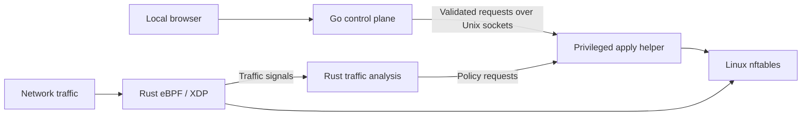

<h1 align="center">FR_OS Community Edition</h1>

<p align="center">
  <strong>A Linux firewall and router for the hardware you already own.</strong>
</p>

<p align="center">
  Turn a spare PC or mini PC into a router you manage from your own network.
  Set firewall rules, connect remotely with WireGuard, and see what your
  devices are doing from one local dashboard.
</p>

<p align="center">
  <a href="https://github.com/starsmash29/FR_OS-Community/releases">Download</a>
  · <a href="#quick-start">Quick start</a>
  · <a href="#what-you-can-do">Features</a>
  · <a href="#how-it-works">Architecture</a>
</p>

<p align="center">
  <a href="go.mod"></a>
  <a href="Cargo.toml"></a>
  <a href="LICENSE"></a>
</p>

FR_OS Community Edition is a Debian-based firewall and router operating
system for homelabs. It combines Linux-native packet filtering with a
browser-based control panel, local DNS controls and traffic analysis.
Configuration and analysis stay on the router. There is no cloud account
or telemetry.

## What you can do

| In your homelab | With FR_OS |
| --- | --- |
| Keep cameras and smart plugs away from trusted devices | Separate devices into zones, define which traffic can cross between them, and isolate individual IoT devices. |
| Reach your lab while away | Give each device its own WireGuard peer and govern access with firewall rules. |
| Cut down unwanted traffic | Apply local DNS blocklists by category and use XDP to filter by visible TLS server names without decrypting traffic. |
| Find out what is exposed | Use the local dashboard to inspect listening services and see which network zones can reach them. |
| Spot unusual device activity | Analyse traffic patterns on the router and quarantine flagged devices with nftables. |
| Share administration | Give operators separate accounts, use passkeys or authenticator codes, and review administrative activity in the local audit log. |

## Quick start

Use a spare x86-64 PC or a Linux VM with two network interfaces. Start on
a test network so you can check the WAN and LAN assignments before moving
devices behind the router.

1. Open [Releases](https://github.com/starsmash29/FR_OS-Community/releases)
   and select the Community Edition release for your hardware. Read the
   release notes for image verification and supported boot modes.
2. Write the installer image to a USB drive or attach it as a virtual
   boot disk. Boot FR_OS with one interface for upstream access and one
   for your test LAN.
3. Follow the console's setup prompts and open the local dashboard from
   the LAN. Confirm the interface roles before applying firewall changes.
4. Start with one client. Check that it gets a LAN address, resolves DNS
   and reaches the internet. Then create your first zone or add a
   WireGuard peer.

## How it works



- **Go handles configuration and policy.** The web interface, validation
  and ruleset generation are separated from privileged changes, which
  go through a dedicated helper.
- **Rust handles traffic-facing code.** Parsers and XDP components
  analyse packet and protocol data. Go and Rust services communicate
  over Unix sockets using a shared, validated JSON wire format.
- **Linux enforces the rules.** nftables handles firewall policy and
  kernel sets. XDP handles early packet filtering on configured
  interfaces.

## Compatibility with earlier FR_OS releases

The Go and Rust codebase carries forward behaviour from the earlier
Python implementation. Tests replay cases captured from a
[pinned FR_OS reference](reference/PIN). The nftables builder compares
generated ruleset text byte for byte, and both languages run the same
[wire-format test cases](testdata/ipc/vectors.json). Read the
[differential test design](AGENTS.md#differential-tests-1x-is-the-specification)
for the covered cases and how intentional differences are recorded.

## Build and test

Use the Linux toolchains pinned in [go.mod](go.mod) and
[rust-toolchain.toml](rust-toolchain.toml). From the repository root:

```bash
go test ./...
cargo test --locked
```

See [AGENTS.md](AGENTS.md) for the source layout, privilege boundaries and
development workflow.

## Security and licence

Please report vulnerabilities privately using the process in
[SECURITY.md](SECURITY.md).

FR_OS Community Edition is licensed under
[GNU AGPLv3](LICENSE) (`AGPL-3.0-only`). See [LEGAL.md](LEGAL.md) for
trademark and third-party notices.
