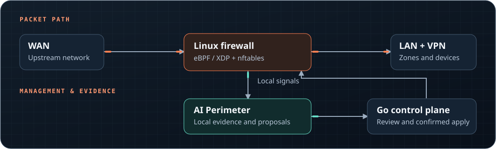
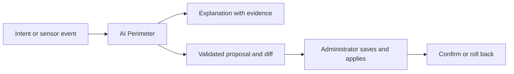

<h1 align="center">FR_OS Community Edition</h1>

<p align="center">
  <picture>
    <source media="(prefers-color-scheme: dark)" srcset="docs/media/FROSCOMWHI.svg">
    
  </picture>
</p>

<p align="center"><strong>Turn a spare PC into a Linux firewall that can explain what it sees.</strong></p>

<p align="center">
  Segment your network, connect with WireGuard, and investigate suspicious
  devices from a local dashboard. AI Perimeter explains the evidence and
  drafts firewall changes for you to review.
</p>

<p align="center">
  <a href="#100-local"></a>
  <a href="go.mod"></a>
  <a href="Cargo.toml"></a>
  <a href="LICENSE"></a>
</p>

<p align="center">
  <a href="https://github.com/starsmash29/FR_OS-Community/releases"><strong>Download</strong></a>
  · <a href="#installation--deployment">Quick start</a>
  · <a href="#ai-perimeter">AI Perimeter</a>
  · <a href="#system-architecture">Architecture</a>
  · <a href="#contributing">Contributing</a>
</p>

<p align="center">
  
</p>

FR_OS Community Edition is a Debian-based firewall and router OS for x86-64
homelabs. It combines the original FR_OS firewall, the AI Perimeter assistant,
and the hackathon work in one Go and Rust codebase.

### 100% Local

The firewall, dashboard, traffic analysis and configuration
work without a cloud account or vendor telemetry. AI Perimeter can use a model
on your own hardware. Connecting a cloud model is optional and sends the
selected request and its redacted context to that provider. Prometheus
monitoring is a separate, opt-in pull endpoint that you control.

## 🌟 Core pillars

| Pillar | What it lets you do |
| --- | --- |
| **Linux-native firewall** | Enforce stateful rules and zone boundaries with nftables. Filter by visible TLS server names with eBPF/XDP, without decrypting traffic. |
| **WireGuard and local access control** | Give each remote device its own WireGuard peer. Require a local sign-in for protected zones, with session expiry enforced in the kernel. |
| **Network visibility** | Inspect which services are reachable from each zone, discover IoT devices, and see applications inferred from DNS and TLS names. |
| **Local detection and response** | Use DNS category lists, TLS fingerprints and per-device traffic baselines to identify unwanted activity. Quarantine flagged devices through the firewall. |
| **AI Perimeter** | Ask why a device was flagged or describe a rule in plain language. Inspect the evidence and configuration diff before applying changes. |
| **Operator controls** | Use admin and read-only accounts, passkeys or TOTP, local audit records, and confirmed apply with rollback. |

## AI Perimeter

Ask **“Why was this laptop flagged?”** or **“Keep the kids’ tablet offline
after 10 p.m. on school nights.”** AI Perimeter can explain what the sensors
observed or turn your request into a proposed configuration change.

| Workflow | What happens |
| --- | --- |
| **Explain an incident** | The assistant uses a pseudonymised evidence bundle from local IDS, DNS, App-ID, JA4 and XDP signals. The explanation cites individual observations that you can inspect. |
| **Review Shadow AI use** | See which devices appear to contact AI services. Optional upload accounting estimates transfer volumes from sampled connections and DNS attribution. Short-lived flows can be missed. |
| **Propose a change** | The assistant produces a structured proposal for supported changes to firewall rules, app controls, ZTNA or WireGuard peers. The config validator, policy checks and rule linter run before you see the diff. |
| **Save, apply and confirm** | An administrator reviews and saves the proposal, then applies it through the firewall. Confirm the apply after checking connectivity. The firewall rolls back an unconfirmed change. |

The assistant runs without access to the privileged apply socket. It receives a
redacted configuration summary for proposals and a separate pseudonymised
bundle for explanations. Passwords, API tokens and WireGuard private keys are
excluded. Proposal context can still include device and rule details.



**See the workflow in action.** The original AI Perimeter demo shows an
incident on real router hardware using a simulated attack scenario.
[Watch the 2:40 demo](https://youtu.be/4aiUjXjpO1M)

## System architecture

- **Go control plane.** The local WebUI, configuration validation, ruleset
  generation and apply orchestration run separately from the packet path.
- **Rust traffic services.** Traffic-facing parsers and eBPF/XDP components
  handle signals close to the kernel.
- **Linux data plane.** nftables handles stateful policy and expiring sets.
  XDP handles early filtering and collects selected handshake signals.
- **Privilege boundary.** The WebUI and sensors send validated requests over
  Unix sockets. The apply helper checks the calling process and its permitted
  operations before changing router state.

Go and Rust communicate using one JSON object per line over Unix sockets.
Both implementations use the same [protocol test vectors](testdata/ipc/vectors.json).
[Architecture and source layout](AGENTS.md#which-language-does-what)

## Installation & deployment

1. Download the amd64 installer image from [Releases](https://github.com/starsmash29/FR_OS-Community/releases).
   Verify it using the checksum and signing instructions for that release.
2. Write the image to a USB drive or attach it to a VM with two virtual network
   interfaces. For a physical test router, connect one interface upstream and
   the other to a test client or isolated switch.
3. Boot the image. Use the address and first-login instructions shown on the
   console. Confirm which port is WAN and which is LAN before moving any
   production devices.
4. From the LAN, open the dashboard. Verify DHCP, DNS and internet access with
   one client, then add firewall zones or a WireGuard peer.
5. For persistent use, follow the release notes for supported storage and
   persistence. If you enable AI Perimeter, configure a model endpoint on the
   router or another machine you operate.

### Hardware requirements

| Component | Homelab starting point |
| --- | --- |
| CPU | x86-64 PC or VM, 2 cores for a basic router |
| RAM | 2 GB for basic routing. Allow 4–8 GB for a feature-rich lab. |
| Storage | Bootable USB for evaluation. An SSD gives you room for persistent settings and logs. |
| Networking | Two Linux-supported Ethernet interfaces or two virtual NICs |
| Boot | Use a BIOS or UEFI mode supported by the release image. Check the release notes for Secure Boot. |
| Local model | Optional and sized separately. A model can run on another host on your LAN. |

The router figures are planning baselines from the original FR_OS build.
Check the Community Edition release notes for supported hardware and tested
performance. Native XDP availability depends on the network driver.

## WebUI

Use the local browser dashboard to manage interfaces, firewall rules, NAT,
DNS and WireGuard. The attack-surface view shows listening services and the
zones that can reach them. Separate admin and viewer roles let others inspect
the network while keeping configuration changes with administrators. Sign-in
supports WebAuthn security keys or passkeys and TOTP.

## IoT devices

Build a local inventory using DHCP leases, neighbour discovery and mDNS.
Review the signals behind each classification, then choose internet-only
isolation or a full block for the device. You can review the inventory before
enabling automatic isolation.

## Applications

See which applications devices appear to use based on local DNS queries and,
when enabled, visible TLS server names. Apply app blocks in the resolver and
optionally on the XDP path. Attribution depends on the names the router can
observe.

## Time-based rules

Apply a rule on specific days and at specific times in the router's configured
time zone. For example, block internet access for a tablet on school nights
while leaving daytime access available. Rules can optionally cut established
connections when a scheduled block begins.

## TLS fingerprints

JA4 and JA3 describe characteristics of the TLS ClientHello. FR_OS uses them
to show which TLS clients it observes per device, flag unfamiliar
fingerprints and enforce configured blocklists. Fingerprints are one signal
alongside DNS, app and connection activity.

## AI IDS/IPS

The on-router detector compares a device's recent connection rate,
destination diversity and available DNS or TLS signals against its own
baseline. It can quarantine devices with nftables. The detector raises the
signal locally, and AI Perimeter can explain the evidence behind it when
requested.

## Telemetry & Grafana

Enable the token-protected Prometheus endpoint if you want to monitor one
router or a fleet. Your own Prometheus server pulls the metrics. Use Grafana
to track interface throughput, CPU and memory, active VPN or access sessions
where reported, DNS and XDP block counters, and device quarantines. For
multi-site monitoring, scrape over verified TLS and keep the endpoint
restricted to your monitoring network.

## Testing

Run the Go and Rust suites on Linux with the pinned [Go](go.mod) and
[Rust](rust-toolchain.toml) toolchains.

```bash
go vet ./...
go test ./...
cargo fmt --all --check
cargo clippy --locked --all-targets
cargo test --locked
```

Compatibility tests replay cases captured from a
[pinned FR_OS reference](reference/PIN), including byte-for-byte comparisons
of generated nftables rulesets. The hackathon work also added isolated WebUI
process tests and corrected helper tests so they can run unprivileged.
The original AI Perimeter evaluation includes ambiguous requests, unsafe
requests and prompt-injection cases.
[Differential testing](AGENTS.md#differential-tests-1x-is-the-specification) ·
[AI evaluation methodology](https://github.com/starsmash29/fr-os-ai-perimeter/tree/main/docs/eval)

## How FR_OS compares

| Platform | Deployment focus | Traffic visibility and enforcement | Management workflow |
| --- | --- | --- | --- |
| **FR_OS Community Edition** | Debian-based x86-64 homelab router on your own hardware or VM | nftables and eBPF/XDP. Local DNS, TLS metadata and behavioural signals feed detection. | Local WebUI. AI Perimeter cites evidence and proposes changes for an administrator to approve. |
| **pfSense** | FreeBSD-based firewall and router | Stateful firewall rules, routing and VPN capabilities, with packages for additional features. | Web-based administration and an established package ecosystem. [pfSense documentation](https://docs.netgate.com/pfsense/en/latest/general/index.html) |
| **OPNsense** | Firewall and router for interface-based policy and routing | Stateful packet filtering, per-interface rules and policy-based routing. | Web-based policy management, with API support in the modern firewall rules implementation. [OPNsense documentation](https://docs.opnsense.org/manual/firewall.html) |
| **OpenWrt** | Linux router distribution with device-specific builds | nftables through firewall4, with policy configured through UCI. | Choose hardware supported by OpenWrt and configure policy through its firewall tooling. [OpenWrt documentation](https://openwrt.org/docs/guide-user/firewall/netfilter_iptables/netfilter_management) |
| **Cisco Secure Firewall (NGFW)** | Commercial enterprise firewall family for network and cloud deployments | Application visibility and control, Snort-based intrusion prevention, URL filtering and file or malware inspection. | Central policy, monitoring and investigation through Firewall Management Center. [Cisco NGFW overview](https://www.cisco.com/site/us/en/learn/topics/security/what-is-a-next-generation-firewall.html) · [Cisco Secure Firewall capabilities](https://www.cisco.com/c/en/us/products/collateral/security/firewalls/fm-secure-firewalls-fmc-cis-controls-v8-1-sb.html) |
| **Palo Alto Networks NGFW** | Commercial enterprise firewall family for network and cloud deployments | App-ID and User-ID support application- and identity-aware policy. The platform supports threat prevention and configurable TLS decryption. | Manage devices individually or centrally with Panorama. [Palo Alto NGFW overview](https://www.paloaltonetworks.com/cyberpedia/what-is-a-next-generation-firewall-ngfw) · [Palo Alto Networks product capabilities](https://www.paloaltonetworks.com/network-security/next-generation-firewall) |

FR_OS's app and TLS visibility uses observable DNS names and handshake
metadata. The enterprise NGFWs cover broader inspection and central policy
management use cases. This table describes documented capabilities. For a
deployment decision, verify model, subscription, hardware, throughput and
support requirements separately.

## Contributing

Start with [AGENTS.md](AGENTS.md) for the repository layout, current
contribution status and checks. For a bug report, include the release,
hardware or VM setup and steps to reproduce. Remove credentials and private
network details from logs before sharing them.

Report vulnerabilities privately through GitHub using the
[security policy](SECURITY.md).

## Licence

[GNU AGPLv3](LICENSE) (`AGPL-3.0-only`). See [LEGAL.md](LEGAL.md) for
trademark and third-party notices.
