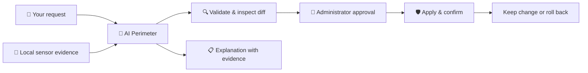

<p align="center">
  <picture>
    <source media="(prefers-color-scheme: dark)" srcset="docs/media/FROSCOMWHI.svg">
    
  </picture>
</p>

<h1 align="center">FR_OS Community Edition</h1>
<h3 align="center">Your network has a story. See it. Understand it. Take control.</h3>

<p align="center">
  A camera reaching an unfamiliar server. A laptop contacting an AI service.<br>
  A firewall rule you need to change without losing access.<br><br>
  <strong>Bring the traffic, the evidence and the next decision into one local dashboard.</strong>
</p>

<p align="center">
  Open-source Linux firewall &amp; router · Local AI Perimeter · Your hardware, your control
</p>

<p align="center"><strong>Built in Rust &amp; Go · Go JSON powered by <code>encoding/json/v2</code></strong></p>

<p align="center">
  <a href="#100-local"></a>
  <a href="Cargo.toml"></a>
  <a href="go.mod"></a>
  <a href="LICENSE"></a>
</p>

<p align="center">
  <a href="#installation--deployment"><strong>Start your first deployment</strong></a>
  · <a href="https://youtu.be/4aiUjXjpO1M"><strong>Watch AI Perimeter</strong></a>
  · <a href="#how-fros-compares"><strong>Compare platforms</strong></a>
  · <a href="#system-architecture"><strong>Explore the architecture</strong></a>
</p>

---

## A firewall you can investigate. A network you can understand.

Your router sits at the crossing point of your digital life. Work laptops,
phones, cameras, game consoles and a growing collection of connected devices
all pass through it. FR_OS Community Edition puts that vantage point to work.

**See which devices are talking. Investigate what changed. Decide what happens next.**

Run a Debian-based firewall and router on your own x86-64 hardware or in a VM.
Separate trusted devices from IoT, connect through WireGuard, schedule access
and inspect local DNS, application and TLS signals. When something looks
wrong, AI Perimeter helps turn the observations into an explanation you can
check and a configuration proposal you can review.

The FR_OS firewall, AI Perimeter and the hackathon work come together as
**one Community Edition**, with a **Rust and Go implementation**. Go handles
configuration and orchestration with `encoding/json/v2`; Rust handles
traffic-facing analysis and eBPF/XDP components.

<table>
  <tr>
    <td width="33%" valign="top">
      <h3>🔎 See the activity</h3>
      <p>Discover devices, inspect reachable services and connect DNS, application and TLS observations to the device behind them.</p>
    </td>
    <td width="33%" valign="top">
      <h3>🧠 Understand the evidence</h3>
      <p>Ask why a device was flagged. AI Perimeter builds its explanation from local observations you can inspect.</p>
    </td>
    <td width="33%" valign="top">
      <h3>🛡️ Control the response</h3>
      <p>Isolate a device, restrict an application or review a proposed rule. Apply changes with confirmation and rollback.</p>
    </td>
  </tr>
</table>

## 100% Local

### Your network should work without asking a cloud for permission.

The firewall, WebUI, traffic analysis and configuration work locally,
**without a vendor account or vendor telemetry**. Run the AI model on the
router or on another machine you control. Your own Prometheus and Grafana
can provide monitoring.

Cloud inference is an explicit option. Enabling a cloud model sends selected
requests and redacted context to that provider; context can still include
device and rule details. The default local workflow needs no cloud model.

## 🌟 Core pillars

| What you want | What FR_OS puts in your hands |
| --- | --- |
| **Keep your networks apart** | Stateful nftables policy and zone boundaries for trusted clients, guests and IoT. eBPF/XDP adds early filtering using observable traffic signals. |
| **Reach home securely** | WireGuard peers for individual devices, with local sign-in and expiring access sessions for protected zones. |
| **Find the device behind the activity** | Device discovery, an attack-surface view and application attribution from observable DNS and TLS names. |
| **Catch changes in behaviour** | Per-device baselines, DNS categories and TLS fingerprints help surface suspicious activity. nftables provides quarantine enforcement. |
| **Turn intent into a reviewed rule** | AI Perimeter translates supported plain-language requests into validated configuration proposals with an inspectable diff. |
| **Stay in control of changes** | Administrator and viewer roles, passkeys or TOTP, and apply confirmation with rollback keep the operator in the loop. |

## Put it to work

| Situation | Your next move |
| --- | --- |
| **“This camera should never reach my work laptop.”** | Put IoT in a separate zone, review its reachability and apply the policy you intend. |
| **“Why did this device suddenly get flagged?”** | Inspect the local detection signals, then ask AI Perimeter to explain the evidence. |
| **“Which devices appear to use AI services?”** | Review Shadow AI observations and their DNS or application attribution. |
| **“The tablet needs a bedtime, not a permanent block.”** | Schedule access by day and time, with optional termination of existing connections when the block begins. |
| **“I need remote access to my lab.”** | Create a WireGuard peer and limit the zones and services it may reach. |
| **“I need to change a rule without locking myself out.”** | Inspect the diff, apply the change and confirm connectivity. An unconfirmed apply rolls back. |

## AI Perimeter

### Ask a question. Inspect the evidence. Approve the change.

A detection deserves an explanation. A proposed firewall rule deserves a
review. AI Perimeter connects those two workflows to the network information
already available on your router.

> **“Why was this laptop flagged?”**  
> Investigate a pseudonymised evidence bundle drawn from local IDS, DNS,
> App-ID, JA4 and XDP observations.
>
> **“Keep the kids’ tablet offline after 10 p.m. on school nights.”**  
> Turn a supported request into a structured proposal, inspect the validated
> configuration diff and decide whether to save and apply it.

These are example requests, not captured model responses.

| From question to decision | What you can inspect |
| --- | --- |
| **Explain an incident** | An explanation that cites individual observations from the local evidence bundle. |
| **Investigate Shadow AI** | Devices that appear to contact AI services. Optional upload accounting estimates volumes from sampled connections and DNS attribution; short-lived flows can be missed. |
| **Draft a supported change** | Proposals for firewall rules, application controls, ZTNA or WireGuard peers, checked by configuration validation, policy checks and a rule linter. |
| **Review and save** | The proposed diff before an administrator saves the configuration. |
| **Apply and confirm** | A separate apply step, followed by connectivity confirmation or rollback. |



**You retain the authority to change the firewall.** The assistant cannot
access the privileged apply socket. Proposal context excludes passwords,
API tokens and WireGuard private keys. Explanations use a separate
pseudonymised evidence bundle.

**Watch it on real router hardware.** The original AI Perimeter demo walks
through a simulated attack and the investigation that follows.
[▶ Watch the 2:40 demo](https://youtu.be/4aiUjXjpO1M)

## System architecture

### Rust at the traffic boundary. Go at the controls. Linux on the packet path.

<p align="center">
  
</p>

Traffic enforcement, analysis and administration have distinct jobs. The
architecture keeps those jobs in separate processes with explicit permission
boundaries, so a dashboard request goes through validation before it can
change router state.

- **Go control plane.** The local WebUI, configuration validation, ruleset
  generation and apply orchestration run separately from the packet path.
- **Rust traffic services.** Traffic-facing parsers and eBPF/XDP components
  handle signals close to the kernel.
- **Linux data plane.** nftables handles stateful policy and expiring sets.
  XDP handles early filtering and collects selected handshake signals.
- **Privilege boundary.** The WebUI and sensors send validated requests over
  Unix sockets. The apply helper checks the calling process and its permitted
  operations before changing router state.

Go and Rust communicate using one JSON object per line over Unix sockets.
The Go side uses `encoding/json/v2` from the Go standard library, and the
Rust side uses Serde. Both implementations are checked against the same
[protocol test vectors](testdata/ipc/vectors.json).
[Architecture and source layout](AGENTS.md#which-language-does-what)

## Installation & deployment

### Start with one router and one test client.

Give FR_OS a place between an upstream connection and an isolated test
network. Your first goal is simple: open the dashboard, connect a client,
and see its traffic before building out your policies.

1. Download the amd64 installer image from [Releases](https://github.com/starsmash29/FR_OS-Community/releases).
   Verify it using the checksum and signing instructions for that release.
2. Write the image to a USB drive or attach it to a VM with two virtual network
   interfaces. For a physical test router, connect one interface upstream and
   the other to a test client or isolated switch.
3. Boot the image. Use the address and first-login instructions shown on the
   console. Confirm which port is WAN and which is LAN before moving any
   production devices.
4. From the LAN, open the dashboard. Verify DHCP, DNS and internet access with
   one client, then add firewall zones or a WireGuard peer.
5. For persistent use, follow the release notes for supported storage and
   persistence. If you enable AI Perimeter, configure a model endpoint on the
   router or another machine you operate.

### Hardware requirements

| Component | Homelab starting point |
| --- | --- |
| CPU | x86-64 PC or VM, 2 cores for a basic router |
| RAM | 2 GB for basic routing. Allow 4–8 GB for a feature-rich lab. |
| Storage | Bootable USB for evaluation. An SSD gives you room for persistent settings and logs. |
| Networking | Two Linux-supported Ethernet interfaces or two virtual NICs |
| Boot | Use a BIOS or UEFI mode supported by the release image. Check the release notes for Secure Boot. |
| Local model | Optional and sized separately. A model can run on another host on your LAN. |

The router figures are planning baselines from the original FR_OS build.
Check the Community Edition release notes for supported hardware and tested
performance. Native XDP availability depends on the network driver.

## WebUI

### The place where observations become decisions.

Open the local dashboard to manage interfaces, firewall rules, NAT, DNS and
WireGuard. Move from a device or a listening service to the network policy
that governs it, with an attack-surface view showing which zones can reach
which services.

Use a **viewer account** to share visibility and an **administrator account**
to change configuration. WebAuthn security keys or passkeys and TOTP support
local sign-in. Review changes before applying them, then confirm that the
network still behaves as intended.

## IoT devices

### Give every connected device a place — and a boundary.

Cameras, speakers and smart plugs need connectivity. The local inventory
combines DHCP leases, neighbour discovery and mDNS to help you identify
them and inspect the signals behind their classification.

Choose **internet-only isolation** or a **full block** for a device. Review
the inventory before enabling automatic isolation, so the policy follows
what you actually know about your network.

## Applications

### Manage what a device connects to, beyond an IP address.

Inspect application activity inferred from local DNS queries and, when
enabled, visible TLS server names. Apply application blocks through the
resolver and optionally the XDP path.

This is useful for spotting unwanted services and keeping access aligned
with a device's purpose. Attribution depends on names the router can
observe; it does not reveal encrypted application payloads.

## Time-based rules

### Let the policy follow the clock.

Give a tablet access during the day and block it on school nights. Define
the days and time windows in the router's configured time zone, then let
the schedule enforce the rule.

When a block begins, optionally terminate established connections so an
already-open session does not outlive the access window.

## TLS fingerprints

### A destination tells you where. A fingerprint adds a clue about what.

JA4 and JA3 describe characteristics of a TLS ClientHello. Use the observed
fingerprints to investigate TLS clients per device, notice unfamiliar
patterns and enforce configured fingerprint blocklists.

Read fingerprints alongside DNS, application and connection activity.
They are investigative signals, not proof of a device's identity or intent.

## AI IDS/IPS

### Notice when a device stops behaving like itself.

The on-router detector compares recent connection rates, destination
diversity and available DNS or TLS signals against a device's own baseline.
That gives you a way to investigate changes in activity alongside
configured categories and blocklists.

The detector can quarantine devices through nftables. AI Perimeter adds
an explanation of the underlying evidence when requested. **Detection
happens locally; an LLM is not required to make the detector run.**

## Telemetry & Grafana

### Your metrics. Your dashboards. Your monitoring server.

Track throughput, resource use, DNS and XDP block counters, device
quarantines and reported VPN or access sessions in your own Grafana
dashboards.

Enable the token-protected Prometheus endpoint, then let your Prometheus
server pull the metrics. This is opt-in operator monitoring, separate from
vendor telemetry. For multiple sites, use verified TLS and restrict the
endpoint to your monitoring network.

## Testing

### The rewrite has to earn its compatibility.

Rust and Go share protocol test vectors, and the ruleset implementation is
checked against captured reference behaviour. The test suites give
contributors a way to check changes against those expectations.

Run the Go and Rust suites on Linux with the pinned [Go](go.mod) and
[Rust](rust-toolchain.toml) toolchains.

```bash
go vet ./...
go test ./...
cargo fmt --all --check
cargo clippy --locked --all-targets
cargo test --locked
```

Compatibility tests replay cases captured from a
[pinned FR_OS reference](reference/PIN), including byte-for-byte comparisons
of generated nftables rulesets. The hackathon work also added isolated WebUI
process tests and corrected helper tests so they can run unprivileged.
The original AI Perimeter evaluation includes ambiguous requests, unsafe
requests and prompt-injection cases.
[Differential testing](AGENTS.md#differential-tests-1x-is-the-specification) ·
[AI evaluation methodology](https://github.com/starsmash29/fr-os-ai-perimeter/tree/main/docs/eval)

## How FR_OS compares

### Choose the firewall that fits the way you want to run your network.

FR_OS brings together an open-source Linux router, local traffic analysis
and an AI-assisted investigation and policy workflow. Its distinctive
combination is **your hardware, local processing, inspectable source and
administrator-approved AI proposals**.

| Platform | Deployment focus | Traffic visibility and enforcement | Management workflow |
| --- | --- | --- | --- |
| **FR_OS Community Edition** | Debian-based x86-64 homelab router on your own hardware or VM | nftables and eBPF/XDP. Local DNS, TLS metadata and behavioural signals feed detection. | Local WebUI. AI Perimeter cites evidence and proposes changes for an administrator to approve. |
| **pfSense** | FreeBSD-based firewall and router | Stateful firewall rules, routing and VPN capabilities, with packages for additional features. | Web-based administration and an established package ecosystem. [pfSense documentation](https://docs.netgate.com/pfsense/en/latest/general/index.html) |
| **OPNsense** | Firewall and router for interface-based policy and routing | Stateful packet filtering, per-interface rules and policy-based routing. | Web-based policy management, with API support in the modern firewall rules implementation. [OPNsense documentation](https://docs.opnsense.org/manual/firewall.html) |
| **OpenWrt** | Linux router distribution with device-specific builds | nftables through firewall4, with policy configured through UCI. | Choose hardware supported by OpenWrt and configure policy through its firewall tooling. [OpenWrt documentation](https://openwrt.org/docs/guide-user/firewall/netfilter_iptables/netfilter_management) |
| **Cisco Secure Firewall (NGFW)** | Commercial enterprise firewall family for network and cloud deployments | Application visibility and control, Snort-based intrusion prevention, URL filtering and file or malware inspection. | Central policy, monitoring and investigation through Firewall Management Center. [Cisco NGFW overview](https://www.cisco.com/site/us/en/learn/topics/security/what-is-a-next-generation-firewall.html) · [Cisco Secure Firewall capabilities](https://www.cisco.com/c/en/us/products/collateral/security/firewalls/fm-secure-firewalls-fmc-cis-controls-v8-1-sb.html) |
| **Palo Alto Networks NGFW** | Commercial enterprise firewall family for network and cloud deployments | App-ID and User-ID support application- and identity-aware policy. The platform supports threat prevention and configurable TLS decryption. | Manage devices individually or centrally with Panorama. [Palo Alto NGFW overview](https://www.paloaltonetworks.com/cyberpedia/what-is-a-next-generation-firewall-ngfw) · [Palo Alto Networks product capabilities](https://www.paloaltonetworks.com/network-security/next-generation-firewall) |

FR_OS's app and TLS visibility uses observable DNS names and handshake
metadata. The enterprise NGFWs cover broader inspection and central policy
management use cases. This table describes documented capabilities. For a
deployment decision, verify model, subscription, hardware, throughput and
support requirements separately.

## Contributing

### Help make the next network easier to understand.

A reproducible bug report, a clearer explanation or a well-tested fix can
help the next operator. If FR_OS fits your lab, **star the repository** to
keep it on your radar and share the project with someone building their
own network.

Start with [AGENTS.md](AGENTS.md) for the repository layout, current
contribution status and checks. For a bug report, include the release,
hardware or VM setup and steps to reproduce. Remove credentials and private
network details from logs before sharing them.

Report vulnerabilities privately through GitHub using the
[security policy](SECURITY.md).

## Licence

[GNU AGPLv3](LICENSE) (`AGPL-3.0-only`). See [LEGAL.md](LEGAL.md) for
trademark and third-party notices.

---

<p align="center"><strong>See the activity. Understand the evidence. Control your network.</strong></p>
<p align="center">
  <a href="#installation--deployment">Start with FR_OS</a> ·
  <a href="https://youtu.be/4aiUjXjpO1M">Watch AI Perimeter</a> ·
  <a href="#contributing">Get involved</a>
</p>
