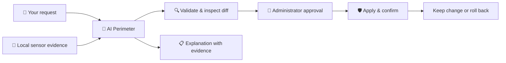
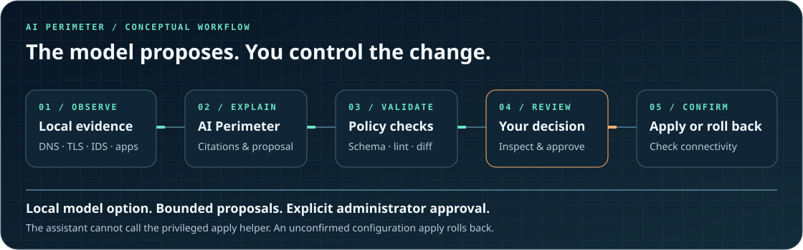

<p align="center">
  <picture>
    <source media="(prefers-color-scheme: dark)" srcset="docs/media/FROSCOMWHI.svg">
    
  </picture>
</p>

<h1 align="center">FR_OS Community Edition</h1>
<h3 align="center">Your network. Your rules. Your AI.</h3>

<p align="center">
  A camera reaching an unfamiliar server. A laptop contacting an AI service.<br>
  A firewall rule you need to change without losing access.<br><br>
  <strong>See the device. Understand the alert. Review the response.</strong>
</p>

<p align="center">
  Open-source Linux firewall &amp; router · Local AI Perimeter · Your hardware, your control
</p>

<p align="center"><strong>Built in Rust &amp; Go · Go JSON powered by <code>encoding/json/v2</code></strong></p>

<p align="center">
  <a href="#100-local"></a>
  <a href="Cargo.toml"></a>
  <a href="go.mod"></a>
  <a href="LICENSE"></a>
</p>

<p align="center">
  <a href="#installation--deployment"><strong>Start your first deployment</strong></a>
  · <a href="https://youtu.be/4aiUjXjpO1M"><strong>Watch AI Perimeter</strong></a>
  · <a href="#how-fr_os-compares"><strong>Compare platforms</strong></a>
  · <a href="#system-architecture"><strong>Explore the architecture</strong></a>
</p>

---

<p align="center">
  <a href="#webui"></a>
  <br><sub>Original FR_OS WebUI with demo data. See the gallery for the interface reference behind Community Edition.</sub>
</p>

## Why choose FR_OS Community Edition?

**A local security stack you can understand, inspect and operate on your own hardware.**

- **Bring your own box.** Build around a supported x86-64 PC, mini PC or VM.
- **Keep the core security workflow local.** Firewall policy, device signals and anomaly detection run on your network. A local model can explain the evidence without a cloud AI account.
- **Get an integrated workflow.** DNS categories, application controls, IoT isolation, JA4/JA3 observations and AI-assisted proposals meet in the same product.
- **Use the Community features without an FR_OS feature subscription.** The software is AGPLv3. Hardware, electricity, optional model hosting and third-party services have their own costs and terms.
- **Inspect the implementation.** The Community rewrite uses Rust and Go, including Go's `encoding/json/v2`, with shared protocol vectors and reference-based compatibility checks.

[Explore the features](#-core-pillars) · [See the interface](#webui) ·
[Compare features and subscriptions](#how-fr_os-compares)

## A firewall you can investigate. A network you can understand.

Your router sits at the crossing point of your digital life. Work laptops,
phones, cameras, game consoles and a growing collection of connected devices
all pass through it. FR_OS Community Edition puts that vantage point to work.

**See which devices are talking. Investigate what changed. Decide what happens next.**

Run a Debian-based firewall and router on your own x86-64 hardware or in a VM.
Separate trusted devices from IoT, connect through WireGuard, schedule access
and inspect local DNS, application and TLS signals. When something looks
wrong, AI Perimeter helps turn the observations into an explanation you can
check and a configuration proposal you can review.

The FR_OS firewall, AI Perimeter and the hackathon work come together as
**one Community Edition**, with a **Rust and Go implementation**. Go handles
configuration and orchestration with `encoding/json/v2`; Rust handles
traffic-facing analysis and eBPF/XDP components.

<table>
  <tr>
    <td width="33%" valign="top">
      <h3>🔎 See the activity</h3>
      <p>Discover devices, inspect reachable services and connect DNS, application and TLS observations to the device behind them.</p>
    </td>
    <td width="33%" valign="top">
      <h3>🧠 Understand the evidence</h3>
      <p>Ask why a device was flagged. AI Perimeter builds its explanation from local observations you can inspect.</p>
    </td>
    <td width="33%" valign="top">
      <h3>🛡️ Control the response</h3>
      <p>Isolate a device, restrict an application or review a proposed rule. Apply changes with confirmation and rollback.</p>
    </td>
  </tr>
</table>

## 100% Local

### Your network should work without asking a cloud for permission.

The firewall, WebUI, traffic analysis and configuration work locally,
**without a vendor account or vendor telemetry**. Run the AI model on the
router or on another machine you control. Your own Prometheus and Grafana
can provide monitoring.

Cloud inference is an explicit option. Enabling a cloud model sends selected
requests and redacted context to that provider; context can still include
device and rule details. The default local workflow needs no cloud model.

## 🌟 Core pillars

| What you want | What FR_OS puts in your hands |
| --- | --- |
| **Keep your networks apart** | Stateful nftables policy and zone boundaries for trusted clients, guests and IoT. eBPF/XDP adds early filtering using observable traffic signals. |
| **Reach home securely** | WireGuard peers for individual devices, with local sign-in and expiring access sessions for protected zones. |
| **Find the device behind the activity** | Device discovery, an attack-surface view and application attribution from observable DNS and TLS names. |
| **Catch changes in behaviour** | Per-device baselines, DNS categories and TLS fingerprints help surface suspicious activity. nftables provides quarantine enforcement. |
| **Turn intent into a reviewed rule** | AI Perimeter translates supported plain-language requests into validated configuration proposals with an inspectable diff. |
| **Stay in control of changes** | Administrator and viewer roles, passkeys or TOTP, and apply confirmation with rollback keep the operator in the loop. |

### The security stack, layer by layer

| Layer | Built-in capability | What it changes for you |
| --- | --- | --- |
| Packet enforcement | Linux nftables stateful policy and eBPF/XDP filtering | Zone policy is enforced in the kernel; selected visible TLS names can be filtered early. |
| Remote access | Per-device WireGuard peers | Revoke one device's access without sharing one reusable VPN password. |
| Identity gate | Local ZTNA sign-in with expiring nftables sessions | Add a sign-in requirement to protected zones and let the kernel enforce expiry. |
| DNS defence | Categorised local lists, allowlists and DNS threat signals | Block unwanted domains and investigate bursts of failed or suspicious lookups. |
| Behaviour | Per-source baselines and firewall quarantine | Surface unusual connection activity and enforce a containment decision. |
| Device context | IoT discovery, classification reasons and isolation | Check why a device was classified before restricting its access. |
| Application context | DNS/SNI attribution and application blocking | See inferred app use per client and apply a corresponding name-based policy. |
| TLS context | JA4/JA3 inventory, unfamiliar-fingerprint alerts and blocklists | Add client-handshake evidence without installing a decryption certificate on clients. |
| Access timing | Day/time schedules and optional connection termination | Make a bedtime or office-hours rule apply to existing sessions as well as new ones. |
| Management protection | Passkeys/security keys, TOTP, administrator/viewer roles | Give users the access they need and protect configuration changes. |
| Management cryptography | Hybrid post-quantum key exchange where the installed TLS/SSH stack supports it | Protect management connections with negotiated hybrid algorithms; disclose classical fallback. |
| Change control | Validation, diffs, confirmed apply and rollback | Inspect the intended change and recover from an unconfirmed apply. |
| Visibility | Attack-surface view and opt-in Prometheus monitoring | See exposed services and monitor the router using infrastructure you operate. |
| AI assistance | Incident explanations and validated configuration proposals | Move from a question to supporting evidence or a reviewable policy change. |

## Put it to work

| Situation | Your next move |
| --- | --- |
| **“This camera should never reach my work laptop.”** | Put IoT in a separate zone, review its reachability and apply the policy you intend. |
| **“Why did this device suddenly get flagged?”** | Inspect the local detection signals, then ask AI Perimeter to explain the evidence. |
| **“Which devices appear to use AI services?”** | Review Shadow AI observations and their DNS or application attribution. |
| **“The tablet needs a bedtime, not a permanent block.”** | Schedule access by day and time, with optional termination of existing connections when the block begins. |
| **“I need remote access to my lab.”** | Create a WireGuard peer and limit the zones and services it may reach. |
| **“I need to change a rule without locking myself out.”** | Inspect the diff, apply the change and confirm connectivity. An unconfirmed apply rolls back. |

## AI Perimeter

### Ask a question. Inspect the evidence. Approve the change.

A detection deserves an explanation. A proposed firewall rule deserves a
review. AI Perimeter connects those two workflows to the network information
already available on your router.

> **“Why was this laptop flagged?”**  
> Investigate a pseudonymised evidence bundle drawn from local IDS, DNS,
> App-ID, JA4 and XDP observations.
>
> **“Keep the kids’ tablet offline after 10 p.m. on school nights.”**  
> Turn a supported request into a structured proposal, inspect the validated
> configuration diff and decide whether to save and apply it.

These are example requests, not captured model responses.

| From question to decision | What you can inspect |
| --- | --- |
| **Explain an incident** | An explanation that cites individual observations from the local evidence bundle. |
| **Investigate Shadow AI** | Devices that appear to contact AI services. Optional upload accounting estimates volumes from sampled connections and DNS attribution; short-lived flows can be missed. |
| **Draft a supported change** | Proposals for firewall rules, application controls, ZTNA or WireGuard peers, checked by configuration validation, policy checks and a rule linter. |
| **Review and save** | The proposed diff before an administrator saves the configuration. |
| **Apply and confirm** | A separate apply step, followed by connectivity confirmation or rollback. |



**You retain the authority to change the firewall.** The assistant cannot
access the privileged apply socket. Proposal context excludes passwords,
API tokens and WireGuard private keys. Explanations use a separate
pseudonymised evidence bundle.

**Watch it on real router hardware.** The original AI Perimeter demo walks
through a simulated attack and the investigation that follows.
[▶ Watch the 2:40 demo](https://youtu.be/4aiUjXjpO1M)

### From suspicious activity to a reviewed response

The original AI Perimeter demonstration follows a **simulated attack on a
fictional chip-design company**, running on real router hardware:

1. A laptop produces a TLS fingerprint present on the threat blocklist.
   The router blocks the matching traffic.
2. A file server starts reaching unfamiliar hosts and making random-looking
   DNS queries. Local sensors record the activity and the detector flags it.
3. The operator opens **Explain**. AI Perimeter receives a pseudonymised
   bundle of those observations and returns an explanation with evidence IDs.
4. The operator requests a containment change. The assistant produces a
   proposal; validation and policy checks determine whether it can proceed.
5. The administrator reviews the diff, saves the accepted change, applies it
   and confirms connectivity. An unconfirmed apply rolls back.

The demo's attack and sensor inputs are simulated; it is not a claim of
independently measured detection against a live adversary.
[Original scenario and demo details](https://github.com/starsmash29/fr-os-ai-perimeter#the-headline-scenario-an-attack-on-a-chip-design-firm-simulated)

<p align="center">
  
  <br><sub>Conceptual workflow animation. The administrator controls configuration changes.</sub>
</p>

### Two AI jobs, with different permissions

| | Local anomaly detector | AI Perimeter assistant |
| --- | --- | --- |
| Input | Connection activity and available DNS/TLS signals | A redacted configuration or pseudonymised incident evidence |
| Job | Compare activity with a recent baseline | Explain observations or translate a supported request into a proposal |
| Needs an LLM? | No | Yes, local by default |
| Response | Can request configured firewall quarantine | Cannot directly apply firewall changes |
| Operator control | Configure detection and containment policy | Review the diff, approve/save, then apply and confirm |

Automatic detector quarantine and administrator-approved AI proposals are
separate paths. An LLM outage does not put a model in the packet path.

### What a proposal may change

AI Perimeter handles a bounded set of operations: add, modify or remove
rules; block or unblock an application; adjust supported ZTNA settings;
and add or remove named WireGuard peers. VPN private keys are handled by
the firewall, not generated in a model response.

Every proposal passes through a structured-output schema, full configuration
validation, deterministic deny rules and the firewall rule linter. The
review presents the diff and highlights weakening changes. A proposal is
rechecked against the configuration being saved, so an intervening edit
cannot silently turn an old proposal into a different change.
[Original proposal validation design](https://github.com/starsmash29/fr-os-ai-perimeter#how-a-proposal-is-judged)

### What the explanation can see

Evidence combines available IDS, application, TLS fingerprint, DNS and XDP
observations. Device identities are pseudonymised for explanations. Evidence
items have identifiers, and returned citations are checked against those
items. Model lookups remain inside the supplied bundle.

Shadow AI observations identify apparent use of AI services. Optional upload
accounting estimates volume from sampled connection data and DNS attribution.
It does not read prompts or uploaded documents, and it can miss short-lived
connections. Treat those figures as estimates, not exact data-loss accounting.
[Original evidence workflow](https://github.com/starsmash29/fr-os-ai-perimeter#what-did-the-router-see-a4)

## System architecture

### Rust at the traffic boundary. Go at the controls. Linux on the packet path.

<p align="center">
  
</p>

Traffic enforcement, analysis and administration have distinct jobs. The
architecture keeps those jobs in separate processes with explicit permission
boundaries, so a dashboard request goes through validation before it can
change router state.

- **Go control plane.** The local WebUI, configuration validation, ruleset
  generation and apply orchestration run separately from the packet path.
- **Rust traffic services.** Traffic-facing parsers and eBPF/XDP components
  handle signals close to the kernel.
- **Linux data plane.** nftables handles stateful policy and expiring sets.
  XDP handles early filtering and collects selected handshake signals.
- **Privilege boundary.** The WebUI and sensors send validated requests over
  Unix sockets. The apply helper checks the calling process and its permitted
  operations before changing router state.

Go and Rust communicate using one JSON object per line over Unix sockets.
The Go side uses `encoding/json/v2` from the Go standard library, and the
Rust side uses Serde. Both implementations are checked against the same
[protocol test vectors](testdata/ipc/vectors.json).
[Architecture and source layout](AGENTS.md#which-language-does-what)

### Language and process boundaries

| Component | Implementation | Boundary |
| --- | --- | --- |
| Configuration, validation and ruleset generation | Go | Validated configuration becomes service files and nftables policy. |
| Local WebUI | Go, `net/http` and `html/template` | Server-rendered management under an unprivileged account. |
| Privileged apply helper | Go | Peer identity and allowed operations are checked on a Unix socket. |
| Traffic-facing parsers and sensors | Rust | Separate services parse untrusted network observations. |
| eBPF/XDP programs and loaders | Rust with aya | Kernel-facing code is separated from userland services. |
| IPC | Go `encoding/json/v2` and Rust Serde | One bounded UTF-8 JSON object per line; shared acceptance/rejection vectors. |

**JSON v2 names the Go JSON library, not a new JSON wire-format version.**
Rust and Go remain separate processes, without cgo or a shared FFI binary.
Debian, the Linux kernel and third-party networking components keep their
own implementations; the Rust/Go statement describes FR_OS's application
rewrite.

### Protect the management plane too

Use WebAuthn/passkeys or TOTP alongside role-based administration. The
attack-surface view helps you check which zones can reach listening services.

Hybrid management key exchange uses `X25519MLKEM768` for TLS and
`mlkem768x25519-sha256` for compatible SSH stacks, with disclosed classical
fallback when unavailable. This concerns management connections, not every
connection routed through the firewall or a claim of post-quantum WireGuard.
[Inherited management design](https://github.com/starsmash29/FR_OS-pblk#-core-pillars)

## Installation & deployment

### Start with one router and one test client.

Give FR_OS a place between an upstream connection and an isolated test
network. Your first goal is simple: open the dashboard, connect a client,
and see its traffic before building out your policies.

1. Download the amd64 installer image from [Releases](https://github.com/starsmash29/FR_OS-Community/releases).
   Verify it using the checksum and signing instructions for that release.
2. Write the image to a USB drive or attach it to a VM with two virtual network
   interfaces. For a physical test router, connect one interface upstream and
   the other to a test client or isolated switch.
3. Boot the image. Use the address and first-login instructions shown on the
   console. Confirm which port is WAN and which is LAN before moving any
   production devices.
4. From the LAN, open the dashboard. Verify DHCP, DNS and internet access with
   one client, then add firewall zones or a WireGuard peer.
5. For persistent use, follow the release notes for supported storage and
   persistence. If you enable AI Perimeter, configure a model endpoint on the
   router or another machine you operate.

### First-session checklist

| Check | What to verify before expanding the deployment |
| --- | --- |
| Interfaces | WAN connects upstream; LAN serves only the intended test network. |
| First login | Use the console-provided address and credentials; replace bootstrap credentials as instructed by the release. |
| Client connectivity | One test client receives the intended address, resolves DNS and reaches permitted destinations. |
| Zone policy | A guest or IoT client cannot reach a protected zone unless a rule allows it. |
| Change recovery | Apply a small test change and complete the confirmation workflow while console access remains available. |
| Persistence | Reboot and verify that the release's supported persistent configuration survives. |
| Optional AI | Configure a reachable local model endpoint, submit a harmless proposal and inspect its diff before applying. |

### Hardware requirements

| Component | Homelab starting point |
| --- | --- |
| CPU | x86-64 PC or VM, 2 cores for a basic router |
| RAM | 2 GB for basic routing. Allow 4–8 GB for a feature-rich lab. |
| Storage | Bootable USB for evaluation. An SSD gives you room for persistent settings and logs. |
| Networking | Two Linux-supported Ethernet interfaces or two virtual NICs |
| Boot | Use a BIOS or UEFI mode supported by the release image. Check the release notes for Secure Boot. |
| Local model | Optional and sized separately. A model can run on another host on your LAN. |

The router figures are planning baselines from the original FR_OS build.
Check the Community Edition release notes for supported hardware and tested
performance. Native XDP availability depends on the network driver.

## WebUI

### The place where observations become decisions.

Open the local dashboard to manage interfaces, firewall rules, NAT, DNS and
WireGuard. Move from a device or a listening service to the network policy
that governs it, with an attack-surface view showing which zones can reach
which services.

Use a **viewer account** to share visibility and an **administrator account**
to change configuration. WebAuthn security keys or passkeys and TOTP support
local sign-in. Review changes before applying them, then confirm that the
network still behaves as intended.

### WebUI gallery

These are **actual screenshots from the original FR_OS interface with demo
data**, pinned to a source revision. They show the interface being carried
forward; they are not screenshots of a verified Rust/Go Community release.

| Dashboard — network overview | Sign in — local access |
| --- | --- |
|  |  |
| **Firewall rules — inspect policy** | **IoT devices — review and isolate** |
|  |  |


**Read the interface as a workflow.** Start with the dashboard, identify a
device or service, inspect the governing rule, then review and apply a change.
The attack-surface screen adds the opposite perspective: which service is
reachable, from where, and why?

[Original interface gallery](https://github.com/starsmash29/FR_OS-pblk#webui-phase-3) ·
[AI Perimeter video walkthrough](https://youtu.be/4aiUjXjpO1M)

## IoT devices

### Give every connected device a place — and a boundary.

Cameras, speakers and smart plugs need connectivity. The local inventory
combines DHCP leases, neighbour discovery and mDNS to help you identify
them and inspect the signals behind their classification.

Choose **internet-only isolation** or a **full block** for a device. Review
the inventory before enabling automatic isolation, so the policy follows
what you actually know about your network.

### Discovery before isolation

| Signal | What it contributes |
| --- | --- |
| DHCP lease | A client address and its reported hostname |
| Neighbour/ARP information | Local address-to-device relationships |
| mDNS service discovery | Advertised services that help explain a classification |
| Vendor information, when available | Additional context for the device identity |

Review the classification reasons, choose the zones to scan, and decide
whether to isolate manually or enable automatic isolation. A MAC-based
decision applies where that client identity is visible to the router; it
does not replace segmentation for traffic that stays within the same switch.

## DNS filtering

### Block the unwanted lookup. Keep the evidence.

Choose categories such as malware, phishing, gambling or adult content,
then use allowlists for intentional exceptions. Local DNS query logging can
also expose repeated failed lookups, random-looking domains and known-threat
lookups to the detector.

DNS enforcement can redirect ordinary DNS requests and restrict selected
bypass paths. Encrypted DNS and encrypted client handshakes limit what a
network observer can see; no DNS/SNI feature here promises universal
visibility into every application.

## WireGuard & local ZTNA

### A device key opens the tunnel. Policy decides what it reaches.

Create a WireGuard peer per remote device, then treat the tunnel as a zone
with its own access rules. A peer does not need access to every internal
service simply because it connected successfully.

For zones that require a local sign-in, ZTNA sessions become timed nftables
set entries. Expiry is enforced in the kernel. This is a local access gate,
not a claim to replace every device-posture or identity-provider feature
in an enterprise access platform.

## Applications

### Manage what a device connects to, beyond an IP address.

Inspect application activity inferred from local DNS queries and, when
enabled, visible TLS server names. Apply application blocks through the
resolver and optionally the XDP path.

This is useful for spotting unwanted services and keeping access aligned
with a device's purpose. Attribution depends on names the router can
observe; it does not reveal encrypted application payloads.

### Follow the observation to the policy

1. Enable the local resolver and the query logging needed for attribution.
2. Review the apps inferred from client lookups.
3. Select an application block so its associated names are refused.
4. Where enabled, use visible TLS server names on the XDP path as an
   additional enforcement signal.

For client-originated handshake observation, XDP belongs on the interfaces
receiving that traffic, normally the **LAN side**. Observing only WAN ingress
does not show the same client requests.

## Time-based rules

### Let the policy follow the clock.

Give a tablet access during the day and block it on school nights. Define
the days and time windows in the router's configured time zone, then let
the schedule enforce the rule.

When a block begins, optionally terminate established connections so an
already-open session does not outlive the access window.

### Example policy: school-night access

| Setting | Example |
| --- | --- |
| Device | The tablet's configured MAC address |
| Direction | LAN to WAN |
| Action | Reject |
| Schedule | Weekdays, 21:30–06:30 |
| Time zone | Europe/Budapest |
| Existing connections | Terminate when the scheduled block begins, if selected |

This is a policy example rather than a complete configuration file. The
schedule implementation accounts for overnight windows and daylight-saving
changes. Review the actual rule and the router's time zone before applying.

## TLS fingerprints

### A destination tells you where. A fingerprint adds a clue about what.

JA4 and JA3 describe characteristics of a TLS ClientHello. Use the observed
fingerprints to investigate TLS clients per device, notice unfamiliar
patterns and enforce configured fingerprint blocklists.

Read fingerprints alongside DNS, application and connection activity.
They are investigative signals, not proof of a device's identity or intent.

### From fingerprint to investigation

Inspect a device's fingerprint inventory, check an unfamiliar fingerprint
against its DNS and connection activity, and decide whether a configured
block or quarantine is appropriate. A changed browser or operating-system
TLS stack can also produce a new fingerprint.

The feature reads observable handshake characteristics. It does not decrypt
the session, and encrypted or unavailable handshake metadata reduces
coverage.

## AI IDS/IPS

### Notice when a device stops behaving like itself.

The on-router detector compares recent connection rates, destination
diversity and available DNS or TLS signals against a device's own baseline.
That gives you a way to investigate changes in activity alongside
configured categories and blocklists.

The detector can quarantine devices through nftables. AI Perimeter adds
an explanation of the underlying evidence when requested. **Detection
happens locally; an LLM is not required to make the detector run.**

## Telemetry & Grafana

### Your metrics. Your dashboards. Your monitoring server.

Track throughput, resource use, DNS and XDP block counters, device
quarantines and reported VPN or access sessions in your own Grafana
dashboards.

Enable the token-protected Prometheus endpoint, then let your Prometheus
server pull the metrics. This is opt-in operator monitoring, separate from
vendor telemetry. For multiple sites, use verified TLS and restrict the
endpoint to your monitoring network.

### What to put on the dashboard

| View | Questions it helps answer |
| --- | --- |
| Interface throughput | Which link is busy, and in which direction? |
| CPU, memory and storage | Is the router running out of capacity? |
| DNS and XDP blocks | Which configured controls are actively dropping or refusing traffic? |
| VPN and access sessions | Which reported remote-access sessions are active? |
| Device quarantines | Has containment occurred, and on which router? |
| Fleet overview | Which site deserves a closer look? |

The original project includes concrete Grafana dashboards and a multi-site
Prometheus configuration. They are useful references; check metric names
against the Community release before importing them.
[Router dashboard](https://github.com/starsmash29/FR_OS-pblk/blob/9216247332a15057bd7d29afc55dc1fd4da80e0c/telemetry/grafana-dashboard.json) ·
[Fleet dashboard](https://github.com/starsmash29/FR_OS-pblk/blob/9216247332a15057bd7d29afc55dc1fd4da80e0c/telemetry/grafana-fleet-dashboard.json) ·
[Multi-site configuration](https://github.com/starsmash29/FR_OS-pblk/blob/9216247332a15057bd7d29afc55dc1fd4da80e0c/telemetry/prometheus-multisite.yml)

## Testing

### The rewrite has to earn its compatibility.

Rust and Go share protocol test vectors, and the ruleset implementation is
checked against captured reference behaviour. The test suites give
contributors a way to check changes against those expectations.

Run the Go and Rust suites on Linux with the pinned [Go](go.mod) and
[Rust](rust-toolchain.toml) toolchains.

```bash
go vet ./...
go test ./...
cargo fmt --all --check
cargo clippy --locked --all-targets
cargo test --locked
```

Compatibility tests replay cases captured from a
[pinned FR_OS reference](reference/PIN), including byte-for-byte comparisons
of generated nftables rulesets. The hackathon work also added isolated WebUI
process tests and corrected helper tests so they can run unprivileged.
The original AI Perimeter evaluation includes ambiguous requests, unsafe
requests and prompt-injection cases.
[Differential testing](AGENTS.md#differential-tests-1x-is-the-specification) ·
[AI evaluation methodology](https://github.com/starsmash29/fr-os-ai-perimeter/tree/main/docs/eval)

### Evidence you can follow

| Test area | What the project checks |
| --- | --- |
| Configuration compatibility | Accepted/rejected inputs, validation messages and YAML behaviour against the pinned reference |
| Firewall output | Generated nftables rulesets compared byte for byte |
| Apply and rollback | Helper replies, execution order, service/file state and failure recovery against recorded reference cases |
| Rust/Go protocol | Shared JSON vectors, including invalid inputs and duplicate object names |
| Service boundaries | Sandboxed units and permitted helper operations |
| AI proposals | Supported, ambiguous, dangerous and injected requests evaluated against deterministic checks |

### Published AI Perimeter evaluation

The **original AI Perimeter**, before integration into this rewrite, reports
a 400-case intent suite repeated three times. On **2026-11-01**, Muse Spark
1.3 scored **1,184 correct out of 1,200 runs**, with a median response time
of **4.1 seconds**. The recorded misses were 15 wrong refusals and one
overly broad interpretation of “Stop the internet.”

No tested proposal exposed the router or LAN under that suite's defined
exposure probes. Those probes are finite, and this result is not proof of
universal safety. It is also **not a Community Edition benchmark or a local
model performance result**.
[Evaluation methodology and results](https://github.com/starsmash29/fr-os-ai-perimeter/tree/main/docs/eval)

The hackathon work contributes isolated WebUI tests, helper tests that can
run unprivileged and the reviewed AI workflow. The original firewall,
AI Perimeter and hackathon repositories remain useful evidence trails.
[Firewall source](https://github.com/starsmash29/FR_OS-pblk) ·
[AI Perimeter source](https://github.com/starsmash29/fr-os-ai-perimeter) ·
[Hackathon source](https://github.com/starsmash29/fr_os-hackathon)

## How FR_OS compares

### What is included, what needs an add-on, and what costs extra?

**FR_OS's proposition is an integrated local workflow without an FR_OS
feature subscription:** routing, enforcement, device context, local anomaly
signals and administrator-reviewed AI assistance on hardware you control.

Read the tables by capability, not by the number of checkmarks. Similar
feature names do not imply identical detection coverage or inspection depth.
Vendor references were checked on **9 November 2026**.

### FR_OS, pfSense and OPNsense

**Included** means part of the described product workflow.
**Add-on** means a separately installed component, which may be free.
**Paid** means the named service or edition requires a commercial entitlement.
**Not established** means this comparison does not establish an equivalent;
it is not a claim that no integration exists.

| Capability | FR_OS Community Edition | pfSense | OPNsense |
| --- | --- | --- | --- |
| Firewall engine | Linux nftables, plus Rust eBPF/XDP components | FreeBSD-based firewall; package ecosystem [1] | FreeBSD-based firewall; integrated Suricata/Netmap inspection [2] |
| DNS blocking | Included: categories, allowlists and detector signals | pfBlockerNG add-on [1] | Included: Unbound blocklists and allowlists [3] |
| IDS/IPS approach | Included: local per-source anomaly baselines and nftables quarantine | Snort/Suricata packages; ruleset terms vary [1] | Included: Suricata IDS/IPS; free and commercial rulesets [2] |
| Application controls | Included: DNS/SNI-based attribution and blocking | Inspection packages; an equivalent integrated FR_OS workflow is not established here [1] | Suricata application rules; Zenarmor offers additional controls with edition-dependent licensing [2][4] |
| IoT investigation | Included: local discovery, classification reasons and isolation | Package-based discovery tools; equivalent combined workflow not established [1] | An equivalent combined workflow is not established by the cited docs |
| TLS evidence | Included: per-device JA4/JA3 observations, alerts and configured enforcement | Depends on selected inspection package and version | Depends on inspection engine and version |
| AI explanations and reviewed proposals | AI Perimeter: local model option, evidence citations, validated diff, admin approval | Equivalent local workflow not established by the cited docs | Equivalent local workflow not established by the cited docs |
| Software and extras | AGPLv3; no FR_OS subscription for the described Community features | Free software/packages are available; paid services are separate [5] | Do not confuse included IDS/DNS functions with paid third-party editions [2][3][4] |

The practical FR_OS advantage here is **integration and the local AI workflow**.
Free firewalling and DNS protection are not exclusive to FR_OS, and an
add-on is not automatically a paid feature.

[1 — pfSense packages](https://docs.netgate.com/pfsense/en/latest/packages/list.html) ·
[2 — OPNsense IDS/IPS and rulesets](https://docs.opnsense.org/manual/ips.html) ·
[3 — OPNsense DNS blocking](https://docs.opnsense.org/manual/unbound.html) ·
[4 — Zenarmor editions](https://www.zenarmor.com/docs/opnsense/introduction/zenarmor-editions) ·
[5 — pfSense deployment and services](https://www.pfsense.org/getting-started/)

### FR_OS and commercial NGFW platforms

| Capability / commercial boundary | FR_OS Community Edition | Cisco Secure Firewall NGFW | Palo Alto Networks NGFW |
| --- | --- | --- | --- |
| Acquisition | AGPLv3 software on your supported hardware/VM | Commercial appliance or virtual entitlement [6] | Commercial NGFW platform [8] |
| Application visibility | DNS/SNI attribution and name-based controls | AVC is included in documented Threat Base licensing [6] | App-ID provides application-aware policy [8] |
| Threat prevention | Local anomaly detection and configured quarantine; no FR_OS feature subscription | **Paid:** Threat/IPS subscription [6] | **Paid:** Threat Prevention / Advanced Threat Prevention [7] |
| Category filtering | Local DNS category lists; name-based enforcement | **Paid:** URL category/reputation subscription [6] | **Paid:** Advanced URL Filtering [7] |
| Malware analysis services | No claim of a commercial file-analysis/sandbox equivalent | **Paid:** Malware Defense subscription [6] | **Paid:** enhanced WildFire / Advanced WildFire services [7] |
| IoT context | Local inventory, explained classification and isolation | Scope depends on platform and integrations; not established here | **Paid:** Device Security subscription [7] |
| AI deployment in this comparison | Operator-hosted model option; explanations and reviewed proposals | An equivalent local workflow is not established here | An equivalent local workflow is not established here |
| Fleet operation | Operator-hosted Prometheus/Grafana visibility | Central firewall management offerings [6] | Central management offerings, including subscription tiers [7] |

The **Paid** labels identify actual commercial boundaries. They do not say
that FR_OS duplicates the full corresponding service. DNS lists are not
full URL/content inspection; an anomaly baseline is not a commercial
signature catalogue; an incident explanation is not malware detonation.

[6 — Cisco ordering and licensing](https://www.cisco.com/c/en/us/products/collateral/security/secure-firewall/guide-c07-737902.html) ·
[7 — Palo Alto subscription catalogue](https://docs.paloaltonetworks.com/ngfw/administration/subscriptions/all-subscriptions) ·
[8 — Palo Alto NGFW overview](https://www.paloaltonetworks.com/cyberpedia/what-is-a-next-generation-firewall-ngfw) ·
[Cisco NGFW overview](https://www.cisco.com/site/us/en/learn/topics/security/what-is-a-next-generation-firewall.html)

### Where OpenWrt fits

OpenWrt is another Linux routing option, using nftables through firewall4
and UCI configuration. Its device-specific ecosystem is a different starting
point from FR_OS's x86-64 security-dashboard workflow. Choose supported
hardware first, then compare the packages and operational experience you
need.
[OpenWrt firewall documentation](https://openwrt.org/docs/guide-user/firewall/netfilter_iptables/netfilter_management)

### Choose FR_OS when these are your priorities

- **Local control:** operate the firewall and AI workflow on infrastructure you own.
- **One investigation path:** move from device activity to evidence, explanation and a reviewed proposal.
- **Transparent engineering:** inspect Rust/Go services, privilege boundaries and compatibility tests.
- **Community software economics:** use the included features without purchasing an FR_OS feature subscription.
- **Hands-on deployment:** build and tune a supported x86-64 homelab router or VM.

If you need a contractual support SLA, a certified appliance, a proven HA
design, specific compliance tooling or independently measured throughput,
validate those requirements separately. This README does not establish
equivalence on those dimensions.

## Contributing

### Help make the next network easier to understand.

A reproducible bug report, a clearer explanation or a well-tested fix can
help the next operator. If FR_OS fits your lab, **star the repository** to
keep it on your radar and share the project with someone building their
own network.

Start with [AGENTS.md](AGENTS.md) for the repository layout, current
contribution status and checks. For a bug report, include the release,
hardware or VM setup and steps to reproduce. Remove credentials and private
network details from logs before sharing them.

Report vulnerabilities privately through GitHub using the
[security policy](SECURITY.md).

## Licence

[GNU AGPLv3](LICENSE) (`AGPL-3.0-only`). See [LEGAL.md](LEGAL.md) for
trademark and third-party notices.

---

<p align="center"><strong>See the activity. Understand the evidence. Control your network.</strong></p>
<p align="center">
  <a href="#installation--deployment">Start with FR_OS</a> ·
  <a href="https://youtu.be/4aiUjXjpO1M">Watch AI Perimeter</a> ·
  <a href="#contributing">Get involved</a>
</p>
