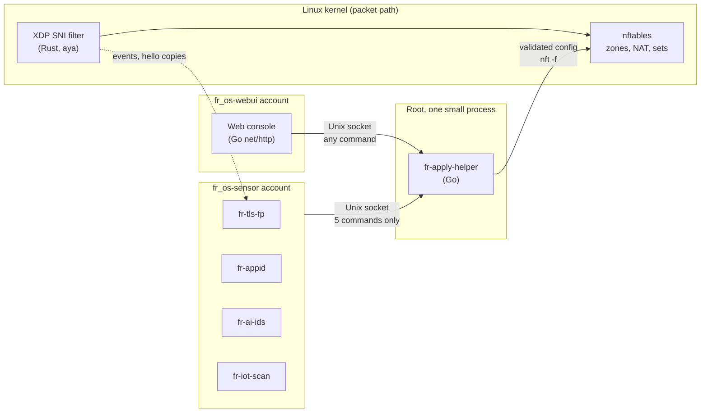

<p align="center">
  <picture>
    <source media="(prefers-color-scheme: dark)" srcset="docs/media/FROSCOMWHI.svg">
    
  </picture>
</p>

<h1 align="center">FR_OS</h1>
<h3 align="center">Your network. Your rules. Your hardware.</h3>

<p align="center">
  An open-source firewall and router for x86-64 PCs and virtual machines.<br>
  Zones, VPN, DNS filtering, device discovery and traffic fingerprinting in one local web console,<br>
  with every change validated, confirmed and reversible.
</p>

<p align="center">
  <a href="LICENSE"></a>
  <a href="#100-local"></a>
  <a href="go.mod"></a>
  <a href="Cargo.toml"></a>
</p>

<p align="center">
  <a href="docs/wiki/index.md"><strong>Read the documentation</strong></a> ·
  <a href="#get-started"><strong>Get started</strong></a> ·
  <a href="#features"><strong>Features</strong></a> ·
  <a href="#how-it-is-built"><strong>Architecture</strong></a>
</p>

---

> **Status: FR_OS 2.0.0 "Ivar" is in preparation.** This repository is the
> Go and Rust rewrite of FR_OS. The firewall, the webUI, the privileged
> helper and every sensor daemon are implemented and tested; the installer
> image is being finished. The first downloadable build will be
> **2.0.0-beta**. Until then you can build and test everything from source.

## Why FR_OS?

**A router sees every device on your network. FR_OS lets you see what it sees, and decide what happens next.**

- **It runs on your box, for you.** No vendor account, no telemetry, no cloud
  dependency. The firewall, the web console and all traffic analysis run on
  the router itself.
- **It is safe to change.** Every edit is validated before it touches the
  system. An apply runs as one transaction that rolls back on failure, and
  you can make it wait for your confirmation: if you lock yourself out, the
  router puts the previous configuration back on its own.
- **It is built to be hard to break.** The web console and the traffic
  parsers run as unprivileged, sandboxed accounts. Root work goes through
  one small helper that checks who is asking and what they may ask for.
  The code that reads traffic strangers send is written in memory-safe Rust.
- **It is tested against a specification.** FR_OS 2 is checked against
  about 23,000 recorded cases from FR_OS 1.x: the same config gives the
  same nftables ruleset byte for byte, the same files and the same answers.
- **It is free software.** AGPLv3, every feature in this repository, no
  feature subscription.

## Features

<table>
  <tr>
    <td width="33%" valign="top">
      <h3>🧱 Firewall and routing</h3>
      <p>Stateful nftables policy between zones, with a default-deny input and forward chain. NAT masquerade and port forwards, VLANs, DHCP with reservations, and IPv6 on the WAN and LAN (SLAAC, DHCPv6, router advertisements, pinholes).</p>
    </td>
    <td width="33%" valign="top">
      <h3>🔐 Remote access</h3>
      <p>WireGuard with one key per device, dual-stack peers and QR codes for phones. A local zero-trust gate (ZTNA) can require a sign-in before a zone is reachable; the access expires in the kernel.</p>
    </td>
    <td width="33%" valign="top">
      <h3>🧭 DNS filtering</h3>
      <p>A local resolver with blocklist categories, allowlists and local host names. Forced DNS stops clients from bypassing it over plain DNS or DNS over TLS.</p>
    </td>
  </tr>
  <tr>
    <td valign="top">
      <h3>📱 Application control</h3>
      <p>See which apps each client uses from its DNS lookups and TLS server names, and block an app by name at the resolver and, optionally, on the XDP fast path.</p>
    </td>
    <td valign="top">
      <h3>⚡ XDP SNI filter</h3>
      <p>An eBPF/XDP program, written in Rust with aya, reads the server name in TLS ClientHellos at the network driver and drops blocked names before the kernel's network stack sees them, over IPv4 and IPv6 and across split handshakes.</p>
    </td>
    <td valign="top">
      <h3>🔎 TLS fingerprints</h3>
      <p>A JA3 and JA4 inventory of the TLS clients on each device. Alerts on unfamiliar fingerprints, a fingerprint blocklist, and optional quarantine on a match. No certificates on clients, no decryption.</p>
    </td>
  </tr>
  <tr>
    <td valign="top">
      <h3>📡 IoT discovery and isolation</h3>
      <p>Finds devices from DHCP leases, the neighbour table, MAC vendors and mDNS, scores how likely each is an IoT device and says why. Isolate one to internet-only or block it entirely, manually or automatically.</p>
    </td>
    <td valign="top">
      <h3>🚨 AI-IDS</h3>
      <p>A local anomaly detector that learns each device's normal connection rate and destination spread, scores random-looking domain names (DGA), and can quarantine a host through nftables. No cloud model, no external service.</p>
    </td>
    <td valign="top">
      <h3>⏰ Time-based rules</h3>
      <p>Rules that apply on given days and hours, in the router's time zone, across midnight and daylight-saving changes. A rule can also cut connections that were already open when its window starts. Rules can expire.</p>
    </td>
  </tr>
  <tr>
    <td valign="top">
      <h3>🖥️ Web console</h3>
      <p>Server-rendered HTTPS console with no JavaScript framework and nothing loaded from a CDN. Admin and viewer roles, TOTP and WebAuthn security keys, a security checklist, an attack-surface view and a live XDP log.</p>
    </td>
    <td valign="top">
      <h3>📈 Monitoring</h3>
      <p>An opt-in Prometheus endpoint behind a bearer token, for your own Prometheus and Grafana. Rule hit counters, drop logs and an activity log of who changed what.</p>
    </td>
    <td valign="top">
      <h3>🛡️ Management hardening</h3>
      <p>The console and SSH listen only in management zones, with a brute-force jail. The web console prefers hybrid post-quantum key exchange (X25519MLKEM768). With the PQC option on, SSH does too where the installed OpenSSH supports it.</p>
    </td>
  </tr>
</table>

Every feature that is not needed is off, and every service listens only
where it has to. [All features, in detail](docs/wiki/index.md)

## 100% local

FR_OS does not phone home. There is no telemetry, no licence server and no
sign-in to a vendor. The few things that reach the internet are ones you
switch on and point somewhere yourself, such as downloading DNS blocklists
or checking for a new release. Your configuration is one YAML file on the
router, `/etc/fr_os/config.yaml`, and you can read, back up and version it
like any other text file.

## Safe changes, every time

Firewalls are dangerous to edit remotely: one wrong rule and you are
locked out. FR_OS is designed around that moment.

1. **Validate.** The config is checked as a whole before anything changes,
   with a message that names the field and the reason.
2. **Apply as a transaction.** The ruleset, DHCP, DNS, VPN, IPv6 and the
   services are changed in a fixed order. If one step fails, the steps
   before it are rolled back and the error says exactly what was and was not
   put back.
3. **Confirm or revert.** With confirmation on (the default is 300 seconds),
   the router waits for you to confirm from the console. If you can't
   reach it any more, it goes back to the previous configuration on its
   own, and keeps the rejected one for you to fix.
4. **Roll back.** The last 10 rulesets are kept as backups, and one click
   returns to the previous one.

If there is no valid configuration at boot, the router loads a fail-closed
baseline: nothing in, nothing forwarded.

## How it is built



| Part | Language | Why |
| --- | --- | --- |
| Config, ruleset builder, apply-helper, web console | Go | A small, auditable control plane. No cgo; JSON through the standard library's `encoding/json/v2`. |
| TLS fingerprinting, app identification, AI-IDS, IoT discovery | Rust | They parse traffic strangers send, so they are memory-safe and run unprivileged. |
| XDP SNI filter and its loader | Rust with aya | One language from the kernel program to its userland. |

Go and Rust never link into one binary. Each service is its own process,
under its own account, in a full systemd sandbox, and they talk over Unix
sockets with one JSON object per line. The web console may ask the helper
for anything an administrator can do; a sensor daemon may only ask for
five things (ping, quarantine a host, a conntrack sample, the DHCP leases,
IoT isolation), so a bug in a parser is not a path to root.

[Architecture in depth](docs/wiki/concepts/architecture.md) ·
[Privilege model](docs/wiki/concepts/privilege-model.md)

## Get started

**Hardware:** an x86-64 PC, mini PC or VM with two network interfaces,
2 CPU cores and 2 GB of RAM for basic routing (4 GB or more with every
filtering feature on). Native XDP depends on the network driver; FR_OS
falls back to generic XDP where it is missing.

**Install:** the 2.0.0-beta installer image will be published on the
[Releases](https://github.com/starsmash29/FR_OS-Community/releases) page
with its checksums and signature. Boot it, and first boot does the rest:

- it finds the WAN port by listening for the upstream network's DHCP
  server, and picks a LAN address that does not overlap it;
- it writes a minimal, safe configuration: LAN to the internet, the
  console and SSH from the LAN only, nothing open from the WAN;
- it generates an administrator password and shows it on the console,
  together with each port's role and the console's address.

Open `https://<LAN address>/` from a LAN client, sign in, and change the
password. [Installation guide](docs/wiki/getting-started/installation.md) ·
[Your first 30 minutes](docs/wiki/getting-started/first-30-minutes.md)

**Build from source** (Linux, with the toolchains pinned in
[go.mod](go.mod) and [rust-toolchain.toml](rust-toolchain.toml)):

```bash
go vet ./... && go test ./...
cargo fmt --all --check && cargo clippy --all-targets && cargo test
```

## Tested like a firewall should be

FR_OS 2 is a rewrite, and a rewrite must not quietly change what a
firewall does. FR_OS 1.x is treated as the specification: its own test
suite was run with a capture plugin, and every answer was recorded. FR_OS 2
replays those recordings and must match them exactly.

| What is compared with 1.x | How |
| --- | --- |
| Config loading and validation | Same values, same accepted and refused configs, same error message |
| nftables ruleset | Byte for byte, for every accepted config, schedule and clock |
| Files an apply writes (Kea, dnsmasq, dhcpcd, WireGuard, sshd, sysctl) | Byte for byte |
| Applies, confirmations, reverts and rollbacks | Same programs run, in the same order, with the same files left |
| Web console | Same answer to the same request in recorded sessions |
| TLS fingerprints, app identification, AI-IDS, IoT discovery | Same fields, hashes, verdicts and state files, to the last bit of every float |
| XDP program | Same verdict for every frame, run in the kernel with `BPF_PROG_TEST_RUN` |

A difference is either a bug or a written decision
([decisions.md](testdata/reference/decisions.md)). CI also runs `go vet`,
`clippy` with warnings denied, `govulncheck`, `cargo audit`, `shellcheck`,
and a check that every systemd unit is sandboxed.
[How the differential tests work](AGENTS.md#differential-tests-1x-is-the-specification)

## Where FR_OS fits

There are good open-source firewalls already. This is how FR_OS differs,
so you can choose the one that fits.

| | FR_OS | pfSense CE and OPNsense | OpenWrt |
| --- | --- | --- | --- |
| Base system | Debian Linux, nftables and XDP | FreeBSD, pf | Linux, nftables (firewall4) |
| Typical hardware | x86-64 PCs, mini PCs and VMs | x86-64 PCs, appliances and VMs | Consumer routers and embedded boards, also x86 |
| Configuration | One YAML file, validated as a whole | Web interface over an XML configuration | UCI files and the LuCI web interface |
| Written in | Go and Rust | PHP on top of FreeBSD | Mostly C and shell |
| Extending it | Built-in features only | Large package ecosystems | Large package ecosystem |
| Maturity | New: 2.0.0 is its first Go and Rust release | Many years in production | Many years in production |

Choose FR_OS if you want a Linux firewall whose whole control plane you
can read, with device discovery, DNS and TLS signals built in and every
change reversible. Choose one of the others if you need its package
ecosystem, its long track record, or hardware FR_OS doesn't run on.

## Documentation

The full documentation lives in [docs/wiki](docs/wiki/index.md) and will
also be published on the project website.

- [What FR_OS is](docs/wiki/getting-started/what-is-fr-os.md)
- [Hardware](docs/wiki/getting-started/hardware.md) ·
  [Installation](docs/wiki/getting-started/installation.md) ·
  [First boot](docs/wiki/getting-started/first-boot.md) ·
  [Your first 30 minutes](docs/wiki/getting-started/first-30-minutes.md)
- [Architecture](docs/wiki/concepts/architecture.md) ·
  [Privilege model](docs/wiki/concepts/privilege-model.md) ·
  [Zones and segments](docs/wiki/concepts/zones.md) ·
  [Applying changes safely](docs/wiki/concepts/apply-and-rollback.md) ·
  [The configuration file](docs/wiki/concepts/configuration-file.md)

## Contributing

FR_OS 2 is being built in the open by its maintainer, and external
contributions open after the first release. Until then, bug reports and
ideas are welcome. Read [AGENTS.md](AGENTS.md) for how the code is split,
the rules every change follows and what "done" means.

Found a vulnerability? Please report it privately, as described in
[SECURITY.md](SECURITY.md), and never in a public issue.

## Licence

FR_OS is free software under the [GNU AGPLv3](LICENSE) (`AGPL-3.0-only`).
"FR_OS" and the FR_OS logo are trademarks; see [LEGAL.md](LEGAL.md) for
trademark, export and third-party notices.

FR_OS provides tools that can help you secure a network. It does not make a
network unbreakable, and using it does not by itself make you compliant
with any law or standard.

---

<p align="center"><strong>Your network. Your rules. Your hardware.</strong></p>
