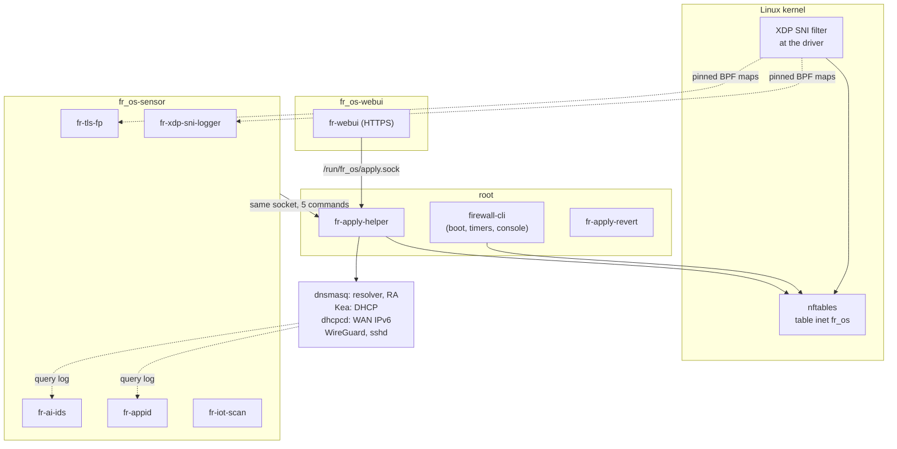

# Architecture

FR_OS is a set of small programs around the Linux kernel's own packet
filter. This page names each one, says what it does and why it is
separate, and shows how they talk.

## The big picture

There are three layers:

1. **The packet path, in the kernel.** nftables holds the whole policy in
   one `inet` table named `fr_os`: the input, forward and output filter
   chains, the NAT chains, and the sets that change at run time (the
   brute-force jail, the IDS quarantine, signed-in ZTNA clients, isolated
   IoT devices). The XDP SNI filter runs earlier still, in the network
   driver, on the ports you choose.
2. **The control plane, in Go.** It turns `config.yaml` into a ruleset and
   service files, applies them, and serves the web console. The only part
   that runs as root while the router is up is the apply-helper.
3. **The sensors, in Rust.** They read traffic metadata (DNS lookups, TLS
   handshakes, conntrack samples, mDNS answers) and report what they see.
   They run unprivileged and can ask the helper for only a handful of
   things.

The standard services FR_OS configures (Kea for DHCPv4, dnsmasq for the
resolver and router advertisements, dhcpcd for IPv6 on the WAN, WireGuard,
OpenSSH) are Debian's own packages. FR_OS writes their configuration files
and starts them; it does not replace them.

## The programs

### Control plane (Go)

| Program | Runs as | Job |
| --- | --- | --- |
| `fr-apply-helper` | root, started by its socket | The one privileged service. Validates requests from the web console and the sensors, applies configurations, loads rulesets, changes the runtime sets, reads the system for the console's views. |
| `fr-webui` | `fr_os-webui` | The HTTPS web console. Server-rendered `html/template` pages, no JavaScript framework, nothing loaded from a CDN. Owns only its own state (accounts, sessions, the login guard, its certificate). |
| `firewall-cli` | root | The router's own commands: the boot's fail-closed apply, validate, render, the schedule check, the blocklist refresh, the query-log trim, account creation, and first boot's commands. |
| `fr-apply-revert` | root | Runs when an apply was not confirmed in time, and puts the previous configuration back. |

### Sensors (Rust)

| Program | Runs as | Job |
| --- | --- | --- |
| `fr-tls-fp` | `fr_os-sensor` | Reads copies of TLS ClientHellos that the XDP program reports, computes JA3 and JA4, keeps the per-device inventory, raises alerts on unfamiliar fingerprints, and asks the helper to quarantine on a blocklist match when configured. |
| `fr-appid` | `fr_os-sensor` | Follows the resolver's query log and the SNI event file, and attributes each name to an application from the catalogue, per client. |
| `fr-ai-ids` | `fr_os-sensor` | Builds a baseline per device from conntrack samples and DNS lookups, scores names for DGA patterns, flags anomalies, and can ask the helper to quarantine a host. |
| `fr-iot-scan` | `fr_os-sensor`, on a timer | Combines DHCP leases, the neighbour table, the IEEE MAC registry and mDNS, scores each device and asks the helper to isolate the ones that should be. |
| `fr-xdp-sni-logger` | `fr_os-sensor` | Reads the XDP filter's events from its ring buffer and writes them to the event file the console's live log reads. |
| `fr-xdp` | root, called by the apply | Loads and pins the XDP program, attaches it, syncs its blocklist and switches, and reads its counters. |

The two programs that read pinned BPF maps (`fr-tls-fp`,
`fr-xdp-sni-logger`) start as root only long enough to open them, then
become `fr_os-sensor` for good before reading any packet data.

The sensors never read `config.yaml` itself. An apply writes
`/etc/fr_os/sensor-view.json`, a JSON view with only what the sensors need.

## How they talk

Every connection between FR_OS's own programs is a **Unix socket** carrying
**one JSON object per line**. The apply-helper listens on
`/run/fr_os/apply.sock`, mode `0660`, group `fr_os-feeds`; the web console
and the sensors reach it through that group.

A line is refused unless it is valid UTF-8, valid JSON, an object, within
the size limit, and has no name twice in any object. Go and Rust implement
this independently (`ipc/` and `crates/fros-ipc`) and both run the same
test vectors (`testdata/ipc/vectors.json`), including the invalid ones.

The helper identifies each caller by the kernel's peer credentials
(`SO_PEERCRED`), not by anything the caller says. See the
[privilege model](privilege-model.md).

## Why two languages

| | Go | Rust |
| --- | --- | --- |
| Used for | Config, ruleset builder, apply-helper, web console | Traffic parsers, XDP program and its loader |
| Because | A small, readable, auditable control plane with a strong standard library: `net/http`, `html/template`, `crypto/*`, and `encoding/json/v2` | The parsers read bytes that strangers send. Memory safety without a garbage collector, and one language from the kernel program (with [aya](https://aya-rs.dev)) to its userland |
| Rules | No cgo (`CGO_ENABLED=0`); JSON only through `encoding/json/v2` | Userland crates `forbid(unsafe_code)`; only the eBPF crates use `unsafe`, each block with its reason |

Go and Rust never link into one binary. Each program is its own process
under its own account, so a fault in one cannot corrupt another's memory.

## The sandbox

Every systemd unit FR_OS ships has a full sandbox: `NoNewPrivileges`,
`ProtectSystem=strict` with explicit writable paths, private `/tmp` and
devices, protected kernel tunables, modules, logs and control groups,
restricted namespaces, a system-call filter, and the capabilities the
service needs and no more. A test (`systemd/sandbox_test.go`) checks every
unit, so a new service can't be added without one.

## Where things live on the router

| Path | What |
| --- | --- |
| `/etc/fr_os/config.yaml` | The configuration: the one source of truth |
| `/etc/fr_os/backups/` | The last 10 rulesets, as `ruleset-*.nft` |
| `/etc/fr_os/webui/` | The web console's accounts, sessions and certificate |
| `/etc/fr_os/sensors/` | The sensors' state: fingerprint inventory, app usage |
| `/etc/fr_os/sensor-view.json` | The sensors' view of the configuration |
| `/run/fr_os/apply.sock` | The apply-helper's socket |
| `/usr/libexec/fr_os/` | FR_OS's binaries |
| `/var/log/fr_os/` | FR_OS's logs, such as the activity log (`audit.log`) |
| `/var/log/fr_os-dns/queries.log` | The resolver's query log, when query logging is on |
| `/var/log/fr_os-sni/events.jsonl` | The XDP filter's events |

## Tested against FR_OS 1.x

FR_OS 2 rewrites FR_OS 1.x, which was in Python, and keeps its behaviour.
1.x's own test suite, plus extra edge-case suites, were run with a capture
plugin that recorded every answer: about 23,000 cases in
`testdata/reference/`. FR_OS 2's tests replay them:

- the config loader must accept and refuse the same configs, with the same
  message, and load them to the same values;
- the ruleset builder must produce the same nftables script, byte for byte;
- the renderers must write the same files, byte for byte;
- the helper must give the same reply to the same request;
- an apply must run the same programs, in the same order, and leave the
  same files;
- the web console must give the same answer in recorded sessions;
- the sensors must compute the same fingerprints, verdicts and state
  files;
- the XDP program, run in the kernel with `BPF_PROG_TEST_RUN`, must give
  every recorded frame the same verdict and leave the same state.

The recording is pinned to one 1.x commit (`reference/PIN`). A difference
is either a bug in FR_OS 2 or a decision, written down in
`testdata/reference/decisions.md` with the cases it changes and why.
