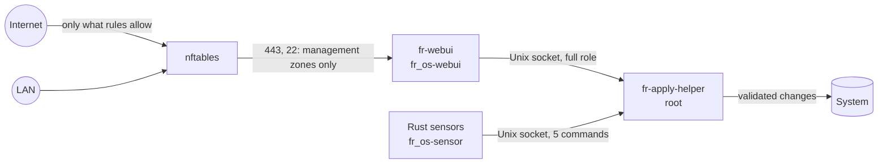

# Privilege model

A firewall is attacked from the networks it protects and from the
internet. FR_OS is built so that the parts exposed to those networks have
the least power, and the one part with power is exposed to nothing but a
local socket.

## The rule

> The web console and the traffic parsers never run privileged code.
> Root work goes through one helper, and each caller may ask it only for
> what its role allows.

## The accounts

| Account | Used by | What it can do |
| --- | --- | --- |
| `root` | `fr-apply-helper`, `firewall-cli`, `fr-apply-revert`, the boot units | Change the system. Exposed only through the helper's Unix socket and the machine's own console. |
| `fr_os-webui` | The web console | Its own state under `/etc/fr_os/webui`. Everything else goes through the helper. It has no journal access; what it shows of the system comes from the helper. |
| `fr_os-sensor` | The Rust sensor daemons | Their own state under `/etc/fr_os/sensors`, the logs they read, and five helper commands. |
| `fr_os-feeds` (group) | The web console and the sensors | Reach the helper's socket and read the resolver's query log and the XDP event file. |
| Daemon users | dnsmasq for the resolver and for router advertisements | Each dnsmasq instance starts as root only to bind its port, then runs as its own unprivileged user (a dynamic user for router advertisements). |

The accounts are created by `firewall-cli ensure-accounts`
(`fr-accounts.service`), which runs early on every boot, so a missing one
is put back.

## The apply-helper and its roles

The helper reads the caller's uid from the kernel (`SO_PEERCRED`) for every
connection, then looks up its role:

| Role | Who | May send |
| --- | --- | --- |
| **Full** | root, the helper's own uid, `fr_os-webui` | Every command |
| **Sensor** | `fr_os-sensor` | `ping`, `quarantine_ip`, `conntrack_sample`, `dhcp_leases`, `iot_sync_isolation` |
| **None** | anyone else | Nothing, not even `ping` |

If one uid were both, the narrower role wins.

Why the sensors get so little: they parse what strangers send. If a bug in
a parser ever let an attacker run code as `fr_os-sensor`, the most that
account could ask for is to quarantine a host or re-sync IoT isolation. It
can't save a configuration or apply one, so a parser bug is not one line
of JSON away from root.

### What the web console may ask for

The console has the full role, but every request it forwards is checked
again in the helper:

- a configuration is fully validated by the same loader before it is
  saved or applied;
- every value that reaches a command line, an nft script or a file has
  been validated in one place, the `config` package, and positional values
  follow `--`;
- the console itself checks the session, the CSRF token and the account's
  role (administrator or viewer) before it asks.

## Management access

The web console (TCP 443) and SSH (TCP 22) are reachable only from the
**management zones**:

- the zones listed in `management.zones`, if any;
- otherwise every zone that does not face the internet (a zone faces the
  internet when NAT masquerades out of it, or when it is named `wan`).

These drops come before every rule you write, so a rule such as "allow 443
from wan" cannot open the console to the internet. The only way to manage
the router from an internet-facing zone is `management.allow_wan: true`:
the configuration refuses an internet-facing zone in `management.zones`
without it, and the security checklist flags it when it is on. The recommended way to manage a router remotely is the
WireGuard VPN.

The console and SSH can also be bound to chosen addresses only
(`management.addresses`). A change that would take away the address you
are connected from is refused, and moving the console's address is itself
held for confirmation from the new address.

### Brute-force protection

Failed sign-ins to the web console are counted two ways, and the counts
survive a restart of the console:

- **Per source:** 5 failures within 5 minutes and the source is put in
  the brute-force jail for an hour. The jail is an nftables set checked
  first in the input chain, so the source's packets are dropped before any
  other rule. An IPv6 source is jailed by its MAC address, so hopping
  between addresses in its /64 does not get around it.
- **Per account:** 10 failures within 15 minutes, from any number of
  sources, and sign-in to that account is refused for the rest of the
  window, except from a source it signed in from successfully in the last
  90 days. An attacker can't lock the owner out that way.

## Accounts in the web console

| Role | Can |
| --- | --- |
| **admin** | Everything: every screen, every change, accounts and policies |
| **viewer** | See every screen. Change only their own password and second factors, and sign out everywhere |

- The account first boot generates must be renamed and given a new
  password on first sign-in; default names (`admin`, `root`, ...) are
  refused.
- Passwords are at least 12 characters, not common, not repetitive, and
  do not contain the username.
- Second factors: TOTP and WebAuthn (security keys and passkeys).
  Administrators can be required to have one.
- Sessions are signed cookies that end on the server: signing out ends the
  session everywhere it was copied, and **Sign out everywhere** ends every
  session of the account.

## What runs where, at a glance

