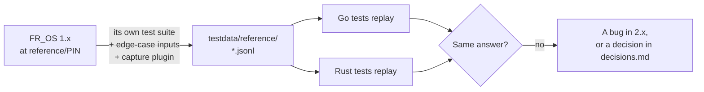

# Testing

A firewall's tests have to show more than "it works": they have to show
it does **exactly** what it did before, on inputs nobody sends on
purpose. FR_OS has four layers of tests.

## 1. The unit and integration tests

```console
$ go vet ./... && go test ./...
$ cargo fmt --all --check && cargo clippy --all-targets && cargo test
```

They prefer the real thing over mocks: real `nft`, real network
namespaces, real sockets. Tests that need root skip themselves without
it. CI (`.github/workflows/ci.yml`) runs them on every push, with
`gofmt`, `shellcheck` on the scripts, `govulncheck` and `cargo audit`.

Two tests need root and run apart:

```console
# The apply-helper and the web console end to end, in a sandbox
$ sudo go test ./webui/ -run TestGoWebUIGoHelperSandbox -v

# An apply attaching the XDP program to a veth pair
$ cargo build -p fros-xdp --bin fr-xdp
$ sudo -E FROS_XDP_REQUIRED=1 go test ./apply/ -run TestXdpRealAttach -v
```

## 2. The differential tests

FR_OS 2 is a rewrite of FR_OS 1.x (Python), and **1.x is the
specification**: FR_OS 2 must do what 1.x does, unless a difference is
decided and written down.



`reference/generate.sh` checks out 1.x at the commit in `reference/PIN`,
runs 1.x's own test suite with a capture plugin, and adds edge-case
inputs written only to record 1.x's answers: odd values Python and PyYAML
let through, every shape of helper request, every config the run saw
accepted, every file an apply writes, whole web console sessions,
ClientHellos cut and damaged, mDNS answers broken every way. The Go
packages and Rust crates then replay them:

| Part | Must match 1.x |
| --- | --- |
| Configuration | The same values from the same YAML, the same YAML written back, the same acceptance and the same error message |
| Ruleset builder | The same nft script, byte for byte |
| Apply-helper | The same reply to the same request, and nft run with the same arguments |
| Renderers | The same files, byte for byte |
| Apply and `firewall-cli` | The same programs run in the same order with the same input and timeout, the same answers, the same files left, the same exit status and output |
| Web console | The same answer to the same request (pages compared as HTML tokens), the same helper requests, the same files |
| TLS fingerprints | The same fields, JA3 and JA4, error texts, reassembly and state file |
| Application identification | The same catalogue, attribution and usage file |
| AI-IDS | The same DGA verdicts and flagged hosts, with the same score to the last bit of every float |
| IoT | The same vendors, neighbours, mDNS services, scores and inventory file |
| DHCP probe | The same DISCOVER frame, byte for byte, and the same reading of every answer |
| XDP program | The same verdict for every frame, the same counters, events, hello copies and flow state |

The recording holds about 23,000 cases (`testdata/reference/summary.json`
counts them per part).

**A difference is a bug or a decision.** A decision gets a line in the
pull request and an entry in `testdata/reference/decisions.md`: which
cases change and why. For example, 1.x accepted a host name with a
trailing newline because its pattern ended in `$`; 2.x refuses it, and
the entry says so. A recorded case is never edited by hand: change the
pin or the inputs, and regenerate.

```console
$ reference/generate.sh /path/to/a/FR_OS-1.x/clone
```

## 3. The XDP program, in the kernel

The XDP program is tested by running it in the kernel with
`BPF_PROG_TEST_RUN` on the frames of the recording: ClientHellos for every
name shape and field value, cut at every byte, behind VLAN tags, IPv4
options and fragments, IPv6 extension headers, split over segments in
order and out of order, with bad checksums, past every limit, and damaged
at random. `reference/generate-xdp.sh` records what 1.x's C program did
with each; the Rust program must do the same.

```console
$ (cd crates/fros-xdp-ebpf && cargo build --release)
$ CARGO_TARGET_X86_64_UNKNOWN_LINUX_GNU_RUNNER='sudo -E' FROS_XDP_REQUIRED=1 cargo test -p fros-xdp
```

CI runs it in its `xdp` job.

## 4. The boot test

The *Build installer ISO* workflow (`.github/workflows/build-installer.yml`)
builds the image and boots it in QEMU, under **BIOS and UEFI**
(`installer/qemu-boot-test.py`). It runs on every pull request that
touches `installer/`, `scripts/` or `systemd/`, and by hand with
`boot_test=true`. The test checks what a real router must do: first boot
picks the WAN and LAN, the firewall loads, the web console answers and its
sign-in and brute-force jail work, the sensors run in their sandboxes with
the right file modes, ZTNA signs a device in, and more. When the router
gains new behaviour, a check for it is added there.

## The rule about tests

A failing test is a finding. Never weaken, skip, delete or quarantine a
test to get green.
