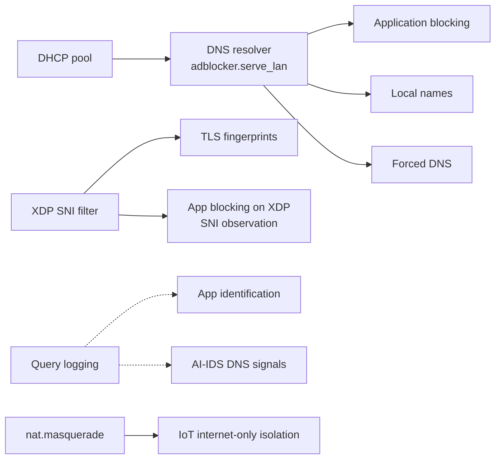

# Features

One page per feature: what it does, how to turn it on, an example, its
limits and how to check that it works. Every key named here is described
in full in the [configuration reference](../reference/configuration.md).

## Network

| Feature | What it does |
| --- | --- |
| [Firewall rules and schedules](firewall-rules.md) | Allow or block traffic between zones, at given times, until a given date |
| [NAT and port forwards](nat.md) | Share one public address; expose a server inside |
| [DHCP](dhcp.md) | Give clients addresses, with fixed reservations |
| [IPv6](ipv6.md) | IPv6 from your provider, on the WAN and the LAN, with pinholes |
| [WireGuard VPN](wireguard.md) | Reach your network from anywhere, one key per device |
| [ZTNA gate](ztna.md) | Make a sign-in the condition for reaching a zone |

## Protection and visibility

| Feature | What it does |
| --- | --- |
| [DNS filtering and local names](dns-filtering.md) | A local resolver with blocklists, allowlists and your own host names |
| [Application control](app-control.md) | See which apps clients use; block an app by name |
| [XDP SNI filter](xdp-sni-filter.md) | Drop TLS connections to blocked names at the network driver |
| [TLS fingerprints](tls-fingerprints.md) | Know which TLS clients run on each device; block known-bad ones |
| [IoT discovery and isolation](iot.md) | Find IoT devices, explain why, and fence them in |
| [AI-IDS](ai-ids.md) | Notice when a device stops behaving like itself, and quarantine it |
| [Monitoring and logs](monitoring.md) | Prometheus metrics, drop logs, hit counters and the audit log |

## How the features depend on each other

Some features build on others, and the configuration refuses a
combination that could not work:

Solid arrows are requirements the loader enforces; dotted arrows are
inputs a feature uses when they are there.
