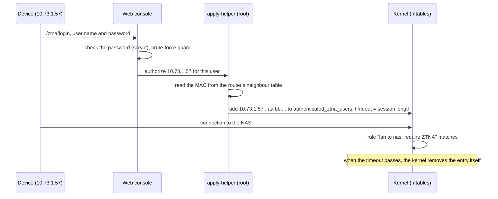

# ZTNA gate

Some parts of a network should not be open to every device that happens
to be plugged in: the NAS with the family photos, the office server, the
camera recorder. The **ZTNA gate** (zero trust network access) makes a
sign-in the condition: a rule marked *Require ZTNA* matches only devices
whose user has signed in at the gate, and only for as long as the session
lasts.

It is entirely local: the accounts are in `config.yaml`, the check is in
the kernel's firewall, and no identity provider or cloud service is
involved.

## How it works



- **A device is its address and its MAC.** On the router's own networks,
  the gate records the address *and* the MAC the router's neighbour table
  holds for it, read by root right after the sign-in arrived. Nothing the
  device says is believed. Another device that takes the same address
  doesn't get in, because its MAC differs.
- **Through the VPN** a device is its tunnel address, which WireGuard
  binds to the device's key.
- **Behind another router or NAT**, many devices share one address and the
  router can't tell them apart, so the gate refuses to sign them in. The
  status page says so and suggests the VPN.
- **The kernel enforces the session.** The entry has a timeout in the
  nftables set; when it passes, the kernel drops it on its own. No timer
  or daemon keeps you signed in, and nothing has to run for the session to
  end.
- **An apply keeps the sessions.** Loading a new ruleset carries the
  signed-in devices over, so nobody is signed out because an admin changed
  a rule.

## Turn it on

```yaml
zones:
  wan: {}
  lan: {}
  nas: {}

ztna:
  enabled: true
  session_ttl_seconds: 28800      # 8 hours; 60 seconds to 30 days
  users:
    - {username: alice, password_hash: "<set by the console>"}

rules:
  - name: lan-to-nas
    action: accept
    from_zone: lan
    to_zone: nas
    require_ztna: true
```

Add the accounts on the **ZTNA Gate** screen, under **Add account**: a user
name and a password. The password follows the same rules as the console's
(at least 12 characters, not one of the common passwords attackers try
first) and is stored only as a scrypt hash. Never write a password in
`config.yaml`. `ztna.enabled` needs at least one account.

Then tick **Require ZTNA** on the rules that should need a sign-in, on the
**Rules** screen (or `require_ztna: true` in the config), and click
**Apply**. The **Gated rules** card of the ZTNA Gate screen lists them.

ZTNA accounts are separate from the console's admin accounts: a ZTNA user
can sign in at the gate and nothing else.

## Signing in

Users open the gate's pages on the router's web console address:

| Page | For |
| --- | --- |
| `https://<router>/ztna/login` | Sign in with the ZTNA account |
| `https://<router>/ztna/status` | Whether this device is signed in, as which user, with which MAC, and the time left |

Neither page needs an admin sign-in. The gate is served by the web
console, so it is reachable from the [management zones](../reference/configuration.md#management)
only; with the default settings that is every zone that doesn't face the
internet, the VPN included. From the internet, sign in through the
[VPN](wireguard.md).

The status page asks the firewall every time: what it shows is what the
kernel enforces, not a cookie.

## Protection against guessing

Sign-ins at the gate go through the same brute-force guard as the
console's (see [Brute-force protection](../concepts/privilege-model.md#brute-force-protection)): repeated
failures from one source put it in the jail, and repeated failures for one
account lock that account, except from sources it signed in from before.
An unknown user name takes as long to refuse as a wrong password, so the
gate doesn't reveal which names exist.

## Limits

- Address plus MAC identifies a device on a network you control; it is
  not a cryptographic identity. Someone on the same network segment who
  copies both the address and the MAC of a signed-in device can ride on
  its session. Use short sessions for sensitive zones, and the VPN, where
  the identity is the device's key, for anything more.
- A sign-in covers the addresses the router knows for the device at that
  moment: the one it signed in from and every other address the
  neighbour table holds for its MAC on that link (its IPv6 addresses, for
  example); through the VPN, both of its tunnel addresses. A device that
  later takes a new address, such as a fresh IPv6 privacy address, must
  sign in again for it.
- There is one level: signed in or not. The gate does not assign
  different users to different rules.

See [`ztna`](../reference/configuration.md#ztna) in the configuration
reference for every key.
