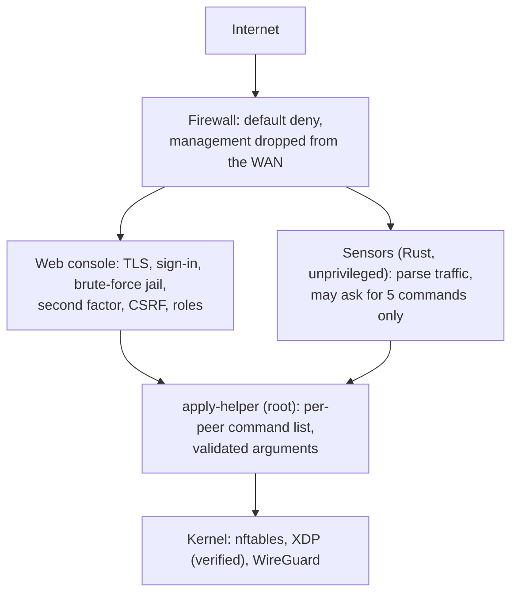

# Security model

FR_OS is built on one assumption: **the firewall itself will be
attacked.** Its design comes from what went wrong at other vendors:
management planes on the internet, default and leaked passwords, config
backups cracked offline, parsers that ran as root, a client that chose how
strictly it was checked. Each lesson became a requirement with an ID,
listed with its current state in
[security-lessons.md](../../security-lessons.md).

This page is the overview. It does not claim FR_OS can't be broken:
no software can promise that. It says what stands between an attacker and
your network, and where to read more.

## Layers

## The management plane

- **Not on the internet by default** (F2, G4). The firewall drops the web
  console (443) and SSH (22) from every zone that isn't a management zone,
  ahead of every rule you write, so an "allow 443 from wan" rule can't
  open them by accident. `management.allow_wan` is the only way, and it
  raises a security alert and costs security score. Use the VPN instead.
- **SSH is keys only** (F3): no passwords, no root login, only members of
  `fr_os-ssh` (an empty group by default), 3 tries, 30 seconds to sign in,
  and it listens only on the management addresses.
- **No default credentials** (G1). First boot generates a random password,
  shows it only on the machine's console, and the first sign-in forces a
  new user name (not `admin`, `root` and the like) and password.
- **Strong hashes** (G2): scrypt with N = 2¹⁵, r = 8, p = 3. An old hash is
  replaced on the next sign-in, and a stored hash can't ask for less work.
- **Phishing-resistant second factors** (G5): security keys and passkeys
  (WebAuthn), or authenticator apps; a policy can require one for every
  admin.
- **Guessing is expensive** (G6): failures are counted per source and per
  account in a file, so a restart doesn't reset them; a source is jailed in
  the kernel, an account locked except from sources it used before.
- **Sessions can be ended** (G7): from the server, on a password or role
  change, and with **Log out everywhere**.
- **Persistence is noticed** (G9): every new admin, reset, removed factor,
  new VPN device, sign-in from a new address and management opened to the
  internet is a security alert on the dashboard and in the audit log.
- **The client never decides** (H1): no field, header or cookie relaxes a
  check. A config that doesn't validate never turns the metrics endpoint
  public; a stored digest that is malformed fails closed.

## Privilege separation

- **Nothing that talks to the network runs as root** (A1, I1). The web
  console runs as `fr_os-webui`; the sensors as `fr_os-sensor`. Root work
  goes through the **apply-helper**, over a Unix socket, which checks the
  caller's account with `SO_PEERCRED` and allows each command per account.
  The sensors may ask for five commands only: ping, quarantine an address,
  sample conntrack, read DHCP leases, sync IoT isolation.
- **Every service is sandboxed** by systemd: its own account, a read-only
  system, private `/tmp`, no new privileges, only the capabilities and
  paths it needs. A test checks every unit's sandbox.
- **Validated before it reaches a command** (F1): every value from the
  configuration or a request is checked in one place (the config package)
  against a strict pattern, anchored at both ends, and `--` comes before
  positional values on every command line that supports it.

See the [privilege model](../concepts/privilege-model.md).

## Untrusted input

- **Memory-safe parsers** (I2). Everything that parses traffic strangers
  send (ClientHellos, DNS logs, mDNS answers, DHCP offers) is Rust, with
  `unsafe` forbidden in every userland crate. The XDP program is Rust too,
  and the kernel's verifier proves it safe before it loads.
- **Size limits everywhere.** Every read from a socket, file or the
  network has a limit; the inventories the sensors keep are bounded, so a
  hostile network can't grow them without end.
- **Hostile shapes are tested.** The XDP program was run in the kernel on
  thousands of recorded frames cut at every byte, damaged at random, split
  out of order and with bad checksums, and must give the same verdict as
  FR_OS 1.x on every one.

## Safe changes

- **Fail-closed boot** (A2, A3). A missing or broken configuration never
  leaves the router open: it falls back to the last good configuration,
  then to a baseline that forwards nothing.
- **Transactions and confirmation.** An apply is checked first, done as a
  whole or undone as a whole, and held for confirmation so a change that
  locks you out undoes itself. See
  [Applying changes safely](../concepts/apply-and-rollback.md).

## Seeing your own exposure

- The **Attack surface** screen (I3, K7) lists every listening port and
  from which zone it is reachable, and flags anything nothing needs.
- The **rule check** (K2) finds rules that accept everything, are open to
  the internet, are shadowed, unused or expired.
- The **Security score** (K8) pulls it together as a checklist with links
  to the fixes.
- Drops, sign-ins and changes are **logged by default** (K6).

## 100% local

FR_OS sends nothing anywhere by itself (G11): no telemetry, no cloud
service, no vendor account, no login through anyone else. Everything that
talks to the internet is something you turn on and can see: the
blocklists you choose, the release check when you open the Update screen,
the updates you install. AI-IDS is statistics running on the router, not a
cloud service.

## Updates

Releases are signed with Ed25519 and refused when the signature doesn't
verify; no build or setting can make that check optional. Debian's
security fixes install daily. See [Updates](../operations/updates.md).

## How FR_OS is checked

- **Differential tests** hold FR_OS 2 to FR_OS 1.x's recorded behaviour on
  about 23,000 cases, so the rewrite cannot quietly change what the
  firewall does. See [Testing](../development/testing.md).
- **Adversarial review** (J2): before every release, the code is
  reviewed by at least two different AI models instructed to attack it,
  and every finding is triaged.
- `govulncheck` and `cargo audit` run in CI; a known vulnerability in a
  dependency blocks the merge.

## Reporting a vulnerability

Please report it privately, never in a public issue: the repository's
**Security** tab, **Report a vulnerability**. The process and the fix
targets are in [SECURITY.md](../../../SECURITY.md).
