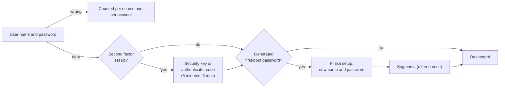

# Signing in and accounts

## Signing in

The sign-in page asks for a user name and a password. Read-only
accounts sign in on the same page.



- **Wrong passwords are counted** per source and per account, and the
  counts survive a restart: 5 failures from one source within 5 minutes
  put it in the brute-force jail for an hour, and 10 failures for one
  account within 15 minutes lock that account, except from sources it
  signed in from in the last 90 days. See
  [Brute-force protection](../concepts/privilege-model.md#brute-force-protection).
- An unknown user name takes as long to refuse as a wrong password.
- When the router has **no account at all**, the page says so and does not
  offer to create one: an account can't be created from the network. Run
  `firewall-cli set-admin-password` on the router as root, then reload.

## Finish setup (the first sign-in)

The first sign-in with the account first boot made (user `admin`, the
password shown on the machine's console) goes straight to **Finish
setup**, and nothing else works until it is done:

| Field | Rule |
| --- | --- |
| **New username** | 1 to 32 characters: lower-case letters, digits, `_`, `.`, `-`, starting with a letter or `_`. Not `admin`, `administrator`, `root`, `user`, `fr_os` or `fros`: the names every password-guessing list tries first. |
| **New password**, **Confirm password** | The password rules below. |

**Save and continue** replaces the account: the generated name and
password stop working, and the password disappears from the console's
login screen.

The next page offers [network segments](network.md#segments) once; you can
skip it.

## Password rules

Every password the console accepts (setup, a new account, a reset, a
change, a ZTNA account) must:

- be at least **12 characters** long;
- not be one of the common passwords attackers try first, nor such a
  password with digits or symbols added at the end;
- not be repetitive (two distinct characters or fewer);
- not contain the user name (of 3 characters or more).

Passwords are stored as **scrypt** hashes (N = 2¹⁵, r = 8, p = 3) in
`/etc/fr_os/webui/auth.json`, readable by root and the console only. A
hash from an older format is replaced on the next successful sign-in.

## Second factor

**Account → Manage second factor** opens the **Second factor** screen.
Adding or removing a factor always asks for the current password.

| Factor | How | Notes |
| --- | --- | --- |
| **Security key or passkey** (FIDO2 / WebAuthn) | Name the key, enter the password, **Add security key**, touch the key | Phishing-resistant: the recommended factor. A key is bound to the name the router was opened by, and browsers allow keys only on a name, not an IP address: open the router as `https://fr-router.lan/` (with a certificate for that name) to add or use one. |
| **Authenticator app** (TOTP) | **Set up authenticator app**, scan the QR code or type the key, enter the 6-digit code and the password, **Turn on** | Works on any address. The key is shown only once. A code can be phished, unlike a security key. |

At sign-in, an account with a factor gets a second step after the
password: **Use security key**, or a code in **Code from the
authenticator app**. The step lasts 5 minutes and allows 5 tries.

**Lost a factor?** Another admin resets it on the **Users** screen
(**Reset** in the *Second factor* column), or run on the router:

```console
# firewall-cli mfa-reset alice
```

### Requiring it

**Users → Second-factor policy → Require a second factor for admins.**
With it on, an admin without a factor can do nothing after signing in
but add one. Viewers are not forced.

## Account screen

Your own account, for every role:

- **Change password**: the current password, then the new one twice.
  Every other session of the account ends; this browser stays signed in.
- **Second factor**: whether one is on, and the way to manage it.
- **Sessions → Log out everywhere**: ends every session of the account,
  on every device, this one too. Use it after signing in on a shared
  computer or when a device went missing.

## Users screen (admins only)

**Accounts** lists every account with its role and second factor:

| Column | Action |
| --- | --- |
| Change role | Switch between `admin` and `viewer` |
| Reset password | Set a new password for the account |
| Second factor | **Reset** removes the account's factors |
| (last) | **Delete** |

At least one admin always remains. Changing a password or a role, or
deleting an account, ends its open sessions immediately.

**Add user** takes a user name, a password and a role (`viewer` by
default).

## The audit log

The bottom of the Users screen shows the latest 200 entries of the audit
log: every sign-in and every change request, with who, when, from where,
which action and the outcome (*denied* when it was refused). Form
contents are never recorded.

Entries that could give someone a way in are also **security alerts**:
a new admin account or an account made admin, an admin's password reset,
a second factor removed, an account signing in from a new address, the VPN
turned on or a new VPN device, and management opened to the internet.
The dashboard shows them to each admin until that admin marks them as
seen. See
[Monitoring and logs](../features/monitoring.md#the-audit-log).
