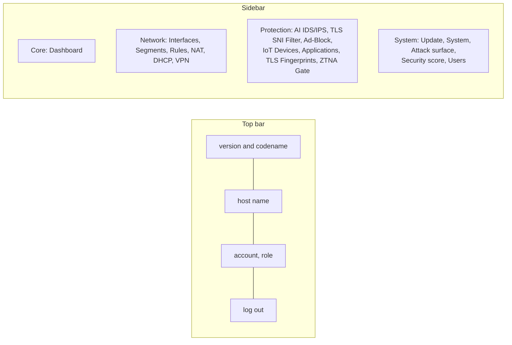

# The web console

The web console (the webUI) is where you run the router day to day. It
is server-rendered HTML served by the router itself: no JavaScript
framework, nothing loaded from the internet, and every page works in any
current browser.

| Page | What it covers |
| --- | --- |
| [Signing in and accounts](accounts.md) | Sign-in, the first-run setup, second factors, the Users and Account screens, the audit log |
| [Dashboard and applying](dashboard.md) | The dashboard, the apply buttons, the confirmation banner, the security alerts |
| [Network screens](network.md) | Interfaces, Segments, Rules, NAT, DHCP, VPN |
| [Protection screens](protection.md) | AI IDS/IPS, TLS SNI Filter, Ad-Block, IoT Devices, Applications, TLS Fingerprints, ZTNA Gate |
| [System screens](system.md) | Update, System, Attack surface, Security score |

## Reaching it

Open `https://<router address>/` from a device in a **management zone**:
by default, every zone that does not face the internet, including the
VPN. After first boot that is the LAN address the console shows, for
example `https://10.73.1.1/`.

The console serves HTTPS only, with a certificate the router made for
itself, so the browser warns the first time. Check the certificate's
SHA-256 fingerprint against the one on the **System** screen (card
*Multi-site monitoring*) once you are in, or download the certificate
there and trust it on your devices.

From the internet, use the [WireGuard VPN](../features/wireguard.md).
Opening the console to the WAN is possible (`management.allow_wan`) but
not recommended, and the security score counts it against you.

## The layout

- The **top bar** shows the installed version and codename, the router's
  host name, your account and role (*Admin* or *Read-only*), and the log
  out button. Your name opens the **Account** screen.
- The **sidebar** groups the screens in four sections. On a narrow
  screen it folds behind the menu button.
- Banners above every page: a **security update** (red) or a new release
  (plain), an **apply waiting for confirmation** with its countdown, and
  for read-only accounts a reminder that changes are disabled.
- Each change answers with a green or red message at the top of the page
  that says what happened, in words.

## Save, then apply

Most screens **save** a change to `/etc/fr_os/config.yaml` and stop
there. A saved change is checked at once (a change the configuration
would refuse is not saved), but the running router only changes when you
click **Apply now** on the dashboard. That lets you make several changes
and apply them together, as one transaction that is undone as a whole if
any step fails. See [Applying changes safely](../concepts/apply-and-rollback.md).

A few actions take effect at once, because waiting would make no sense or
be unsafe; their screens say so:

| Action | Screen |
| --- | --- |
| Trust, isolate or clear an IoT device; Scan now | IoT Devices |
| Move the webUI's address | System (held for confirmation) |
| Refresh the blocklists now | Ad-Block |
| Add or remove a VPN device's key (the key is saved; the tunnel loads it on the next apply) | VPN |
| Accounts, passwords, second factors, sessions | Users, Account |
| Block or unblock a TLS fingerprint (the daemon reads it within 30 seconds) | TLS Fingerprints |

## Roles

| Role | Can |
| --- | --- |
| **admin** | Everything, including the Users screen. |
| **viewer** | See every screen, read-only. Change only its own password and second factors, and log itself out. |

A viewer's change is refused by the server, not just hidden: every
request that changes something checks the role and the session's CSRF
token. There is always at least one admin.

## Sessions

- A session lasts at most **12 hours**; then you sign in again.
- Changing an account's password or role, or deleting it, ends its
  sessions at once. **Log out everywhere** on the Account screen ends every
  session of your account, on every device.
- The session cookie is signed by the router, `HttpOnly`, `SameSite=Lax`
  and, over HTTPS, `Secure`; the router keeps the right to revoke it, so
  a copied cookie stops working when the session is ended.

## What the console never does

- It never runs anything as root itself. Every privileged step, from
  loading the ruleset to reading the kernel's counters, is a request to
  the apply-helper, which checks it (see the
  [privilege model](../concepts/privilege-model.md)).
- It loads nothing from the internet. The only page that contacts an
  outside server is **Update**, which asks GitHub for the latest release
  when you open it.
- It records no form contents in its logs: no password or key reaches
  the audit log.
